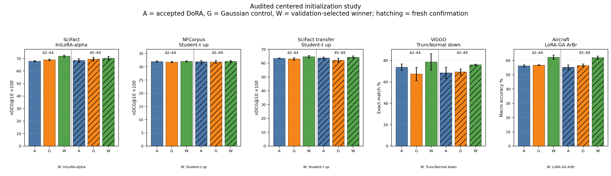
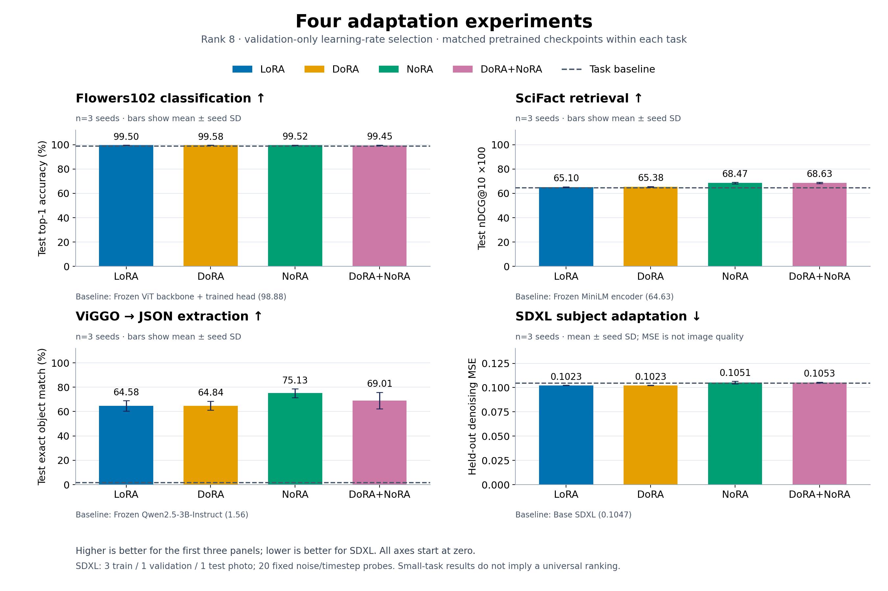
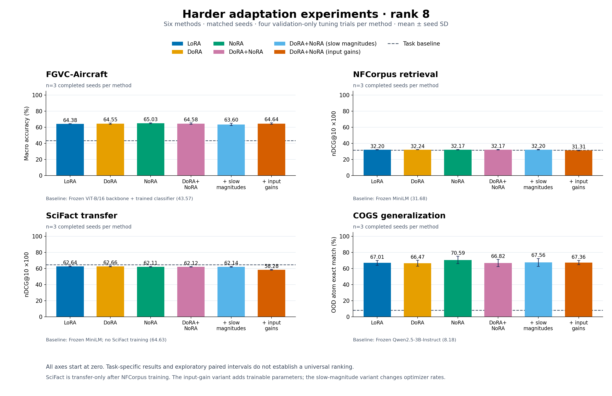
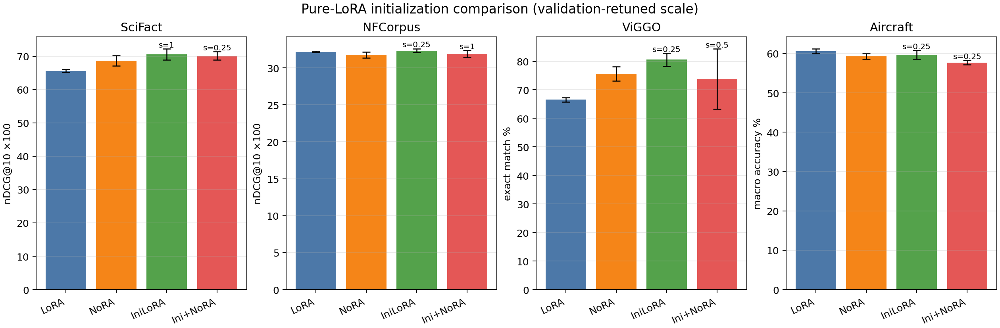
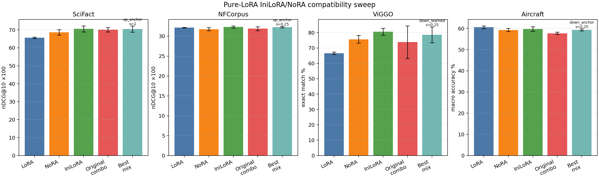

# DoRA

## IniLoRA-alpha × adaptive rank study

The neutral adaptive-rank study is registered in [`configs/methods.yaml`](configs/methods.yaml) with 41 candidate cells and a 959-run plan. The executable harness, pinned references, correctness tests, and blocked-scope notes are in [`reports/methods.md`](reports/methods.md), [`references.md`](references.md), and [`reports/limitations.md`](reports/limitations.md). The host has four RTX PRO 6000 GPUs; the requested MetaMathQA split yields 12,904 deduplicated training groups after the required development reservations, so the 20,000-group scope is explicitly blocked.

Accepted native HPO (348/348, zero failures) ran from [`scripts/continue_native_study.sh`](scripts/continue_native_study.sh) with 8192-token effective updates, supervised-token normalization, BF16 frozen backbone, FP32 adapters, fixed q/o targets, faithful AdaLoRA reference semantics, and equal 12-trial HPO quotas. Full-horizon tuning is now running from the frozen HPO selections; partial records are never promoted to final conclusions. Current coverage is in [`artifacts/coverage.json`](artifacts/coverage.json). Restart, compression/export, equal-compute, official GSM8K/MATH, 7B, heterogeneous-module, and DDP stages remain pending until their implementations and runs are complete.

The selected default [dora.py](dora.py) is the original implementation from `bb97617a0d5e1ad4c6856cb7278f5a7386820d18` with **one change: store trainable magnitudes in FP32**. FP64 inputs retain FP64 magnitudes. The initial norm is computed in the original weight dtype and then cast; norm computation itself is unchanged.

For a PyTorch weight `W` of shape `[out_features, in_features]`:

```text
V = W + A @ B
W_adapted = m * (V / column_norm(V))
y = linear(x, W_adapted, bias)
```

There is one magnitude per input column: `m.shape == (1, in_features)`. Gradients pass through the denominator. The original dense forward and random-normal up-factor / zero down-factor initialization are retained. This is the **“Magnitude FP32 only”** recipe in the [ablation results](results/2026-10-09-change-ablations/validation_tuned_table.md), subject to the task adapters' documented pretrained-model compatibility handling.

## Usage

```bash
python -m pip install -r requirements.txt
python dora.py
python -m unittest -v test_dora
```

```python
import torch
from torch import nn
from dora import DoRALayer, replace_linear_with_dora

base = nn.Linear(128, 64)
layer = DoRALayer(
    d_in=128, d_out=64, rank=8,
    weight=base.weight.detach().clone(),
    bias=base.bias.detach().clone(),
)
x = torch.randn(16, 128)
torch.testing.assert_close(layer(x), base(x))

model = nn.Sequential(nn.Linear(128, 64), nn.ReLU(), nn.Linear(64, 16))
replace_linear_with_dora(model)  # Original in-place helper, rank 4; returns None.
optimizer = torch.optim.AdamW(
    (p for p in model.parameters() if p.requires_grad), lr=1e-3
)
```

The original constructor and helper behavior are preserved: supply pretrained weights and a bias, construct factors on CPU, then move the completed layer to the device. BF16 training uses autocast for mixed-dtype projections. Calling `.half()` or `.bfloat16()` on the completed layer also casts `m` under normal PyTorch behavior; use a device-only move to retain its initialized FP32 storage. The original import-time seed and demo are retained. Its demo prints training-minibatch losses, not held-out task scores.

The six default tests check native-norm initialization followed by storage promotion, original FP32/FP64 output/gradient parity, full column-norm derivatives, and exact CPU/CUDA optimizer trajectories against the measured `ab_m_fp32` recipe, including BF16 autocast. They also verify that small magnitude updates survive storage in FP32.

## Completed initialization study (2026-10-12)

The registered initialization study is complete and independently audited. It compares **76 initializer families** on centered SciFact, NFCorpus, SciFact transfer, ViGGO extraction, and Aircraft, with separate fixed-rate and validation-tuned lanes. The grid covers random distributions, sparse/orthogonal/DCT/Hadamard structures, rank-axis covariance kernels, and source-reviewed PiSSA, MiLoRA, OLoRA, EVA, CorDA, ASTRA, LoRA-GA, LoRA-One, FiLeT, LoRA-DA, CNT, IniLoRA, TLoRA-style, and MiCA-style recipes. Test scores never select settings. Primary results use seeds 42–44; locked fresh confirmation uses seeds 45–49 and is reported separately.

| Task | Accepted DoRA, seeds 42–44 | Validation-selected family, seeds 42–44 | Fresh locked winner, seeds 45–49 | Fresh Δ vs accepted [95% interval] |
|:--|--:|:--|--:|--:|
| SciFact nDCG@10 ×100 | 67.99 ± 0.64 | IniLoRA-alpha: **71.97 ± 0.78** | IniLoRA-alpha: **70.37 ± 1.34** | +1.77 [−0.55, +4.23] |
| NFCorpus nDCG@10 ×100 | 32.02 ± 0.24 | Student-t(df=3) up: **32.09 ± 0.20** | Student-t(df=3) up: **32.05 ± 0.40** | +0.12 [−0.68, +0.91] |
| SciFact transfer ×100 | 63.53 ± 0.24 | Student-t(df=3) up: **64.64 ± 0.84** | Student-t(df=3) up: **64.33 ± 0.90** | +0.61 [−1.09, +2.13] |
| ViGGO exact match % | 73.83 ± 2.95 | Truncated normal (down): **78.78 ± 7.72** | Truncated normal (down): **76.02 ± 0.65** | +7.50 [+1.25, +13.52] |
| Aircraft macro accuracy % | 56.27 ± 0.74 | LoRA-GA ArBr: **62.33 ± 1.46** | LoRA-GA ArBr: **62.04 ± 1.16** | +6.62 [+5.45, +7.77] |



The fresh confirmation strengthens the Aircraft and ViGGO effects. SciFact's confirmation interval includes zero after the validation-selected IniLoRA-alpha result falls from +3.98 points on seeds 42–44 to +1.77 points on seeds 45–49. NFCorpus remains effectively tied. The transfer gain is positive in mean but its interval includes zero. These are task-specific results, not a universal initializer ranking.

The full main report retains every family and both selection lanes: [audited report](results/2026-10-09-initialization-study/final/main_report.md), [all family results](results/2026-10-09-initialization-study/final/all_families.csv), [paired comparisons](results/2026-10-09-initialization-study/final/all_comparisons.csv), and [search budgets](results/2026-10-09-initialization-study/final/search_budgets.csv). The separate [fresh-seed report](results/2026-10-09-initialization-study/final/confirmation_report.md) contains all five locked roles and their paired intervals.

All 255 core scheduler jobs passed: 1,204 pilots and 249 selected finals for centered Aircraft, 1,204 pilots and 357 selected finals for the repeated NFCorpus cohort, and 602 pilots plus 243 selected finals for centered ViGGO. Main, confirmation, and extension reports rebuilt byte-for-byte. Portable saved-prediction replay rescored 1,367,205 rows for the main bundle and 67,680 rows for confirmation with original host paths and network access denied. Tensor payloads are intentionally omitted from portable archives; their original hashes remain bound in the evidence manifests. The original centered NFCorpus historical-baseline mismatch remains preserved and is not silently merged with the repeated valid cohort.

The older section below is retained as a dated partial snapshot from before Aircraft, confirmation, and final review completed. It is superseded by the audited report above.

## Historical partial initialization export (2026-10-09–11)

The broader initialization study is running under a three-day budget. It keeps the accepted public implementation unchanged and varies factor initialization, noise distributions, covariance kernels and source-reviewed literature recipes. The [main protocol](experiments/initialization_protocol.md) and [separate LoRA-Null/GME extension](experiments/initialization_extension_protocol.md) register 4,368 validation pilots, original task LR grids, three-seed final evaluations and a separate five-fresh-seed confirmation of the main validation-selected finalists. These are initializer adaptations to the accepted DoRA geometry; the [literature inventory](experiments/initialization_literature.md) records the boundaries of each method.

The complete separate repetition of the centered NFCorpus grid and its finals now passes the unchanged strict audit. The original historical-baseline mismatch remains unexplained, with its failed audit and artifacts preserved; no individual pilot was replaced or tolerance relaxed. Quantized Qwen's pilot audit passed after correcting the distinction between initial magnitudes and forward denominators. The [recovery note](results/2026-10-09-initialization-study/recovery_note.md) records both cases and the additional compute. The October 12, 17:39:10 UTC deadline and fresh-seed confirmation requirement remain unchanged.

**The completed centered SciFact comparison shows a promising initialization improvement, with fresh-seed confirmation still pending.** All 602 pilots across 76 families finished before test scoring. The best validation configuration uses independent standard-Gaussian draws for both factors and subtracts their initial product, `W + (BA − B₀A₀)`, preserving the starting function. This is a tuned IniLoRA-alpha derivative; it uses no optimization-based prefit. The public implementation remains unchanged.

Rank-8 MiniLM uses 726 training / 81 validation / 300 official-test queries and 115 updates per fit. Values are test nDCG@10 ×100, mean ± sample SD across seeds 42–44. All three displayed configurations selected LR `0.001` using validation only.

| Initialization | SciFact nDCG@10 ×100 ↑ |
|:--|--:|
| Accepted DoRA | 67.99 ± 0.64 |
| Scale-tuned original Gaussian (2×) | 69.01 ± 0.62 |
| Centered Gaussian, both factors (validation-selected) | 71.97 ± 0.78 |


The selected variant gains **3.98 points** over accepted DoRA (exploratory paired 95% interval **[1.64, 6.38]**) and **2.95 points** over scale-tuned Gaussian (**[0.82, 5.09]**). These intervals use 10,000 paired seed/query resamples and have no multiple-comparison correction. The global choice searched all 602 pilots; each four-setting family, including the Gaussian control, had eight pilots, while the exact accepted anchor had two. Seed 42 reuses its selected pilot fit; the separate seeds 45–49 confirmation remains pending. This is evidence on one task, not an overall initializer ranking.

The final audit passed 754 unique fits and 86,710 optimizer updates. All 68,400 final query rankings were rescored for the export. [Selected configurations and paired intervals](results/2026-10-09-initialization-study/centered_scifact_summary.json), [all 76 families in both selection lanes](results/2026-10-09-initialization-study/centered_scifact_all_families.csv), and [search budgets](results/2026-10-09-initialization-study/centered_scifact_search_budgets.json) retain the full comparison.

**The repeated centered NFCorpus comparison and SciFact transfer evaluation are complete.** Student-t(df=3) up-factor initialization was selected from all 1,204 pilots using NFCorpus validation. It has means close to accepted DoRA on NFCorpus and a higher transfer mean, but both paired intervals include zero. The three displayed configurations all selected LR `0.0001`.

| Initialization | NFCorpus | SciFact transfer |
|---|---:|---:|
| Accepted DoRA | 32.02 ± 0.24 | 63.53 ± 0.24 |
| Gaussian scale 2 | 31.82 ± 0.27 | 63.02 ± 0.91 |
| Student-t(df=3) up (validation selected) | 32.09 ± 0.20 | 64.64 ± 0.84 |


Values are nDCG@10 ×100, mean ± sample SD across seeds 42–44. Student-t minus accepted DoRA is +0.07 points on NFCorpus (exploratory paired 95% interval [−0.74, +0.84]) and +1.12 on transfer ([−0.45, +2.81]). This does not establish an improvement. The global validation choice searched 301 initialization settings × four rates; accepted DoRA searches four rates, and each four-setting family searches 16 candidates. Intervals use 10,000 crossed paired seed/query resamples without multiple-comparison correction. Fresh confirmation seeds 45–49 remain pending.

Rank-8 MiniLM uses 2,582/323 deduplicated official train/validation queries, all 323 official NFCorpus test queries and 405 updates per fit. The same checkpoints evaluate all 300 official SciFact test queries without extra tuning. All 76 families and both selection lanes are retained. The final audit passed 1,442 training fits and 584,010 updates; independent reporting review rescored 222,411 final rankings. The [full report, settings, costs and portable replay](results/2026-10-09-initialization-study/centered_nfcorpus/README.md) includes 357 selected checkpoints, with 119 seed-42 pilot reuses and 238 new fits. This validates the repeated cohort; the original mismatch remains unresolved and preserved.

**The separate LoRA-Null/GME extension has completed both retrieval tasks and SciFact transfer.** All four literature variants have lower observed means than the accepted anchor on direct SciFact. NFCorpus differences versus the tuned accepted anchor have paired intervals crossing zero. Settings and learning rates were selected using each training task's validation data; transfer inherits the NFCorpus selections.

| Extension initialization | SciFact direct | NFCorpus | SciFact transfer |
|:--|--:|--:|--:|
| Accepted DoRA | 67.99 ± 0.64 | 32.02 ± 0.24 | 63.53 ± 0.24 |
| Scale-tuned original Gaussian | 69.01 ± 0.62 | 31.82 ± 0.27 | 63.02 ± 0.91 |
| LoRA-Null, task-only centered adaptation | 66.76 ± 0.51 | 31.70 ± 0.09 | 59.77 ± 0.41 |
| GME paper recipe, warm start | 66.20 ± 0.41 | 32.19 ± 0.23 | 61.97 ± 0.95 |
| GME author V1 recipe, warm start | 66.26 ± 0.18 | 32.03 ± 0.28 | 61.34 ± 0.58 |
| GME author V2 recipe, warm start | 66.05 ± 0.42 | 32.02 ± 0.18 | 61.51 ± 0.41 |

Values are test nDCG@10 ×100, mean ± sample SD over seeds 42–44. Null uses task-training activation statistics and does not test pretraining-knowledge retention. The three GME recipes intentionally change the initial model output and remain separate adaptations to the accepted DoRA geometry. The direct SciFact study completed all 42 pilots before test scoring: eight per four-setting family and two for the accepted anchor. NFCorpus completed 84 pilots: 16 per four-setting family and four for the anchor. The GME parent receives 24 and 48 attempts respectively across its three recipes. Transfer adds no training or selection.


The transfer means are lower for all four literature variants. Versus the validation-tuned accepted anchor, Null's difference is −3.76 points (exploratory 95% interval [−5.96, −1.61]); GME V1 and V2 also have intervals below zero, while the paper recipe's interval crosses zero. For the validation-tuned selections, all four same-learning-rate anchor comparisons cross zero on both NFCorpus and transfer, so the tuned differences do not isolate initialization from the selected learning rate. The full report retains both controls and the equally tuned Gaussian family. Intervals use 10,000 paired seed/query resamples without multiple-comparison correction.

Six selected NFCorpus final fits—three each for GME paper and V1—have `b_norm_ratio_ok=false`: their maximum up-factor/base-weight Frobenius norm ratio is approximately 0.00190–0.00205, exceeding the fixed 0.001 small-factor threshold. This flag does not measure whether target moments were equalized. The fits remain finite and pass checkpoint replay. The diagnostic was not a registered numerical-failure gate, so these results retain the flag and remain in the comparison.

The [SciFact extension report](results/2026-10-09-initialization-study/extension_scifact/README.md) and [NFCorpus/transfer extension report](results/2026-10-09-initialization-study/extension_nfcorpus/README.md) retain selected settings, all families and both selection lanes, paired intervals, costs and portable scoring replay. Their task audits passed 54 and 106 unique fits respectively. NFCorpus includes 33 final checkpoints: 30 family-selected fits plus three extra same-learning-rate anchor controls, supplying 20,559 test rankings across both datasets. It uses the recorded deduplicated 2,582/323 train/validation queries, all 323 official test queries and 405 updates per fit; transfer uses all 300 official SciFact test queries. These extension results do not change the main grid's selections or receive its five-fresh-seed confirmation. The completed Aircraft extension is reported below.

**The Qwen/ViGGO LoRA-Null/GME extension is also complete.** None of its treatments demonstrates an improvement over accepted DoRA. GME V1 scores lower with an exploratory paired interval below zero; the other validation-tuned treatment comparisons versus accepted DoRA have intervals containing zero. Both selection lanes are shown because validation tuning chose a different Gaussian scale and learning rate.

| Extension initialization | Fixed LR exact match % | Validation-tuned exact match % |
|:--|--:|--:|
| Accepted DoRA | 73.83 ± 2.95 | 73.83 ± 2.95 |
| Scale-tuned original Gaussian | 73.83 ± 2.95 | 67.45 ± 6.25 |
| LoRA-Null, task-only centered adaptation | 70.57 ± 1.80 | 70.57 ± 1.80 |
| GME paper recipe, warm start | 69.92 ± 1.70 | 69.92 ± 1.70 |
| GME author V1 recipe, warm start | 65.10 ± 2.54 | 65.10 ± 2.54 |
| GME author V2 recipe, warm start | 70.96 ± 5.80 | 70.96 ± 5.80 |


Values are mean ± sample SD across seeds 42–44. Rank-8 Qwen2.5-3B-Instruct uses the registered 1,024/128/256 subsets of the official ViGGO train/validation/test splits, after seven exact-text training duplicates were excluded. This is not the full official test split. Exact match compares schema-valid parsed JSON objects. All 42 pilots used 48 updates; validation NLL selected settings before test scoring. Each four-setting family searches eight candidates; the accepted anchor searches two rates. The fixed rate is `0.0003`. The tuned Gaussian chooses scale 2 and LR `0.0001`; its fixed-rate choice is scale 1. All other families select LR `0.0003` in both lanes.

GME V1's difference versus accepted DoRA is −8.72 points (exploratory paired 95% interval [−16.02, −1.04]). All treatment differences versus the validation-tuned Gaussian have intervals crossing zero. The [full extension report](results/2026-10-09-initialization-study/extension_extraction/README.md) retains same-learning-rate accepted controls, supplementary JSON/schema/slot metrics, all settings and both lanes. Intervals use 10,000 paired seed/example resamples without multiple-comparison correction. Six selected GME final fits, paper and V1 across three seeds, exceed the fixed 0.001 small-factor norm-ratio diagnostic (observed maxima approximately 0.00295–0.00342); they remain finite and pass replay. This diagnostic is neither a moment-matching measurement nor a registered failure exclusion.

The task audit passed 68 fits including two short controls, 8,170 updates, 14,688 checkpoint tensors and all 6,144 final predictions. Four historical accepted fits match bitwise. The 24 fresh 256-update final fits comprise 21 family-selected fits and three extra same-learning-rate anchor controls; no pilot training is reused. Costs and portable scoring replay are retained in the task report. Test NLL remains from original inference. The broader study and main-only fresh-seed confirmation remain pending.

**In the separate SciFact intentional warm-start substudy, the accepted baseline has the highest mean among the six recipes.** All 42 validation pilots finished before test evaluation. Each treatment searches four initializer settings and two learning rates; the one-setting accepted anchor searches only the two rates. The following table uses the same task protocol and seeds, with settings selected using validation. Warm starts retain a nonzero initial update.

CNT abbreviates [ConsNoTrainLoRA](https://arxiv.org/abs/2507.08044), which computes an adapter initialization from pretrained weights and training activations before ordinary fine-tuning. Cross, self and shift name its three constraint formulas; these experiments adapt them to accepted DoRA.

| Initialization | SciFact nDCG@10 ×100 ↑ |
|:--|--:|
| Accepted DoRA | 67.99 ± 0.64 |
| LoRA-One warm start | 66.39 ± 0.26 |
| LoRA-DA warm start | 65.59 ± 0.73 |
| CNT cross warm start | 65.91 ± 0.10 |
| CNT self warm start | 41.09 ± 0.40 |
| CNT shift warm start | 65.47 ± 0.32 |


The [partial report](results/2026-10-09-initialization-study/README.md), [warm-start settings and score provenance](results/2026-10-09-initialization-study/scifact_warmstart_summary.json), and [warm-start task audit](results/2026-10-09-initialization-study/scifact_warmstart_audit.json) retain the evidence. The warm-start audit passed all 54 unique fits, including pilots, and all 5,400 final query rankings were rescored again for this export. Other tasks, quantized results, full runtime analysis and fresh-seed confirmation remain pending.

**The NFCorpus warm-start comparison and its SciFact transfer evaluation are also complete.** LoRA-One and LoRA-DA have similar NFCorpus means to accepted DoRA and lower transfer means; their paired intervals include zero on both datasets. All three CNT warm starts have lower means, with exploratory paired intervals below zero. These are adaptations to the accepted DoRA geometry, not evaluations of each paper's full method.

| Initialization | NFCorpus nDCG@10 ×100 ↑ | SciFact transfer nDCG@10 ×100 ↑ |
|:--|--:|--:|
| Accepted DoRA | 32.02 ± 0.24 | 63.53 ± 0.24 |
| LoRA-One warm start | 32.15 ± 0.02 | 62.16 ± 0.58 |
| LoRA-DA warm start | 32.17 ± 0.13 | 61.68 ± 0.34 |
| CNT cross warm start | 26.70 ± 0.23 | 50.97 ± 0.26 |
| CNT self warm start | 16.97 ± 0.11 | 30.48 ± 0.81 |
| CNT shift warm start | 23.25 ± 0.66 | 38.03 ± 1.12 |


Rank-8 MiniLM uses 2,582 training / 323 validation queries after the recorded exact-text deduplication, all 323 official NFCorpus test queries, and 405 updates per fit. The official train / validation counts before deduplication are 2,590 / 324. Values are mean ± sample SD over seeds 42–44. All settings and learning rates were selected using NFCorpus validation only, after all 84 pilots finished. Each four-setting treatment searches 16 pilots; the accepted anchor searches four learning rates. SciFact transfer evaluates the same trained checkpoints on 300 official test queries, without additional fitting or selection.

The [full NFCorpus warm-start report](results/2026-10-09-initialization-study/warm_nfcorpus/README.md) includes the bar chart, both fixed and tuned selection lanes, paired intervals, costs and portable prediction replay. Its audit verified 106 unique fits and 42,930 updates, including 22 new seed-43/44 fits. The report rescored 20,559 test rankings from 33 selected checkpoints across both datasets. Five-seed confirmation remains reserved for the main centered grid's validation-selected candidates and controls; these warm-start results use seeds 42–44. The broader study is still in progress.

**The Qwen/ViGGO warm-start comparison is complete.** No treatment demonstrates an improvement over accepted DoRA in this three-seed evaluation. LoRA-DA and CNT self have lower exact-match scores with exploratory paired intervals below zero; LoRA-One, CNT cross and CNT shift have intervals crossing zero. Exact match compares schema-valid parsed JSON objects; key order and whitespace do not matter.

| Initialization | ViGGO exact JSON match %, mean ± SD |
|:--|--:|
| Accepted DoRA | 73.83 ± 2.95 |
| LoRA-One warm start | 71.48 ± 3.12 |
| LoRA-DA warm start | 61.85 ± 2.54 |
| CNT cross warm start | 74.48 ± 3.32 |
| CNT self warm start | 0.00 ± 0.00 |
| CNT shift warm start | 74.09 ± 5.19 |


Rank-8 Qwen2.5-3B-Instruct uses deterministic subsets of the official ViGGO splits: 1,024 training / 128 validation / 256 test examples, after seven exact-text training duplicates were excluded. This is a subset evaluation, not the full official test split. All 42 seed-42 pilots used 48 updates and completed before selection by validation NLL. Each treatment searches four initializer settings × two learning rates; the exact anchor searches two rates. Every family selected LR `0.0003`, so fixed and tuned lanes share their final checkpoints. All 18 final fits were freshly trained for 256 updates across seeds 42–44, including seed 42; pilot checkpoints were not reused.

LoRA-DA's difference is −11.98 points (exploratory paired 95% interval [−18.23, −5.73]). CNT self's zero exact match comes from retained predictions across all three seeds; it still produces 90.23% valid JSON on average, but only 11.74% slot F1. Numerical finiteness therefore does not imply successful task learning. These source-specific warm-start adaptations retain their registered nonzero initial updates and CNT sign convention. The intervals use 10,000 paired seed/example resamples without multiple-comparison correction.

The [full Qwen warm-start report](results/2026-10-09-initialization-study/warm_extraction/README.md) includes supplementary JSON/schema/slot metrics, settings, costs and portable prediction replay. The task audit checked 62 fits including two controls, 6,634 updates, 13,392 checkpoint tensors and all 4,608 final predictions, with four historical accepted fits matching bitwise. Saved-prediction replay reproduces the report; it does not independently re-infer test NLL. Aircraft warm-start/extension and quantized retrieval results are reported below; the remaining main-grid tasks, quantized Aircraft and main-only fresh-seed confirmation remain pending. The accepted public implementation is unchanged.

### Completed Aircraft warm starts and extension (2026-10-11)

Several initializations help Aircraft in these separate three-seed studies. LoRA-One and LoRA-DA improve on the accepted anchor by 4.69 and 4.24 points. GME paper scores 61.18% versus 56.27% for accepted DoRA and 56.76% for scale-tuned Gaussian. Its exploratory paired differences are +4.91 [3.24, 6.55] and +4.42 [3.28, 5.60] points, respectively. The main centered search and its fresh-seed confirmation remain pending; this is no cross-task winner claim.

| Initialization | Aircraft macro accuracy %, mean ± sample SD |
|---|---:|
| Accepted DoRA | 56.27 ± 0.74 |
| Scale-tuned Gaussian | 56.76 ± 0.27 |
| LoRA-One warm start | 60.96 ± 1.06 |
| LoRA-DA warm start | 60.50 ± 0.64 |
| CNT cross warm start | 41.41 ± 2.50 |
| CNT self warm start | 10.95 ± 0.66 |
| CNT shift warm start | 33.15 ± 0.90 |
| LoRA-Null, task-only centered | 60.20 ± 0.43 |
| GME paper warm start | 61.18 ± 0.55 |
| GME author V1 warm start | 60.39 ± 0.49 |
| GME author V2 warm start | 60.82 ± 0.04 |


These rank-2 ViT-B/16 runs use all official Aircraft splits (3,334 train / 3,333 validation / 3,333 test). Each task completed 84 ten-epoch pilots before validation-only selection and 18 fresh twenty-epoch final fits at seeds 42–44. All selected families use LR 0.001, so fixed and tuned lanes share checkpoints. Each non-anchor family searches four initializer settings × four rates, versus four rates for the anchor; GME has three separately reported recipes. Intervals use 10,000 paired seed/example resamples with class stratification, without multiplicity correction. Null uses a centered task-only update; the warm starts intentionally change the initial function. These adaptations receive no extra confirmation seeds.

[Aircraft warm-start evidence](results/2026-10-09-initialization-study/warm_aircraft/README.md) and [Aircraft extension evidence](results/2026-10-09-initialization-study/extension_aircraft/README.md) include both selection lanes, costs, raw-prediction reviews and portable report replay. They independently rescore 59,994 final predictions per task. The accepted public implementation remains unchanged.

### Completed dense-NF4 retrieval comparisons (2026-10-11)

Values are test nDCG@10 ×100 over seeds 42–44, with validation-selected settings and learning rates. SciFact transfer uses the NFCorpus selections and checkpoints. Original/quantized names the magnitude initialization source; i1/i3 denotes one/three LoftQ iterations. Each NF4 row is the quantizer-only control paired with the corresponding LoftQ base.

| Recipe | SciFact direct | NFCorpus | SciFact transfer |
|---|---:|---:|---:|
| Accepted DoRA | 67.99 ± 0.64 | 32.02 ± 0.24 | 63.53 ± 0.24 |
| NF4 i1, original magnitude | 67.90 ± 0.55 | 32.19 ± 0.24 | 62.79 ± 0.68 |
| LoftQ i1, original magnitude | 66.69 ± 0.37 | 31.93 ± 0.09 | 61.91 ± 0.38 |
| NF4 i1, quantized magnitude | 67.95 ± 0.57 | 32.19 ± 0.33 | 62.82 ± 0.78 |
| LoftQ i1, quantized magnitude | 66.61 ± 0.70 | 31.94 ± 0.11 | 61.98 ± 0.35 |
| NF4 i3, original magnitude | 68.43 ± 0.46 | 31.94 ± 0.23 | 63.42 ± 0.35 |
| LoftQ i3, original magnitude | 67.41 ± 0.30 | 31.77 ± 0.11 | 62.56 ± 0.41 |
| NF4 i3, quantized magnitude | 68.53 ± 0.60 | 31.98 ± 0.22 | 63.30 ± 0.47 |
| LoftQ i3, quantized magnitude | 67.49 ± 0.60 | 31.66 ± 0.10 | 62.87 ± 0.11 |


These dense dequantized simulations do not measure compressed serving. The [direct SciFact report](results/2026-10-09-initialization-study/quantized_scifact/README.md) and [NFCorpus/transfer report](results/2026-10-09-initialization-study/quantized_nfcorpus/README.md) retain same-base/same-rate controls and paired intervals; comparing tuned means alone does not isolate initialization when selected rates differ. Reviewed scoring replay covers 8,100 and 31,773 final rankings, respectively. Each evaluation uses its full official test split; NFCorpus training/validation excludes exact-text duplicates. Seed-42 full-budget pilots are reused and seeds 43–44 are freshly trained.

The remaining centered NFCorpus/Qwen/Aircraft results, quantized Aircraft results and main-only fresh-seed confirmation are pending. All four task exports above include hash-bound evidence and portable scoring replay; checkpoint tensors remain in the local task roots.

### Completed dense-NF4 Qwen/ViGGO comparison (2026-10-11)

None of the four LoftQ variants demonstrates an improvement over accepted DoRA in this three-seed evaluation. All four means are lower, and every exploratory paired 95% interval includes zero. All four NF4 quantizer-only controls failed during initialization, so same-base comparisons that isolate the initializer are unavailable.

| Recipe | Test JSON exact match %, mean ± sample SD |
|---|---:|
| Accepted DoRA, BF16 base | 73.83 ± 2.95 |
| NF4 i1, original magnitude | Unavailable: initialization failure |
| LoftQ i1, original magnitude | 69.01 ± 2.15 |
| NF4 i1, quantized magnitude | Unavailable: initialization failure |
| LoftQ i1, quantized magnitude | 68.75 ± 1.70 |
| NF4 i3, original magnitude | Unavailable: initialization failure |
| LoftQ i3, original magnitude | 72.14 ± 0.81 |
| NF4 i3, quantized magnitude | Unavailable: initialization failure |
| LoftQ i3, quantized magnitude | 67.97 ± 4.50 |


These rank-8 Qwen2.5-3B-Instruct runs use deterministic subsets of the official ViGGO splits: 1,024 training / 128 validation / 256 test examples after seven training duplicates were excluded. This is a subset evaluation. Settings are selected by validation NLL; every successful family selected LR `0.0003`, so fixed and tuned lanes share checkpoints. Each LoftQ family searches four initializer settings × two rates; the anchor and each quantizer control search two rates. Values use seeds 42–44.

LoftQ uses one or three iterations (i1/i3), with magnitudes initialized from the original or quantized weights. The comparison against accepted DoRA combines quantization and initialization. This dense dequantized NF4 simulation provides no compressed-memory or serving-speed measurement. The closest mean is LoftQ i3 with original magnitudes: −1.69 points versus the BF16 anchor, paired 95% interval [−8.07, +4.82]. Intervals use 10,000 paired seed/example resamples without multiple-comparison correction.

All 42 pilot attempt receipts preceded final test evaluation: 34 successful 48-update fits and eight initialization failures. Final receipts cover 15 successful fresh 256-update fits and 12 failed paired-control attempts. The 20 zero-update failure receipts propagate failed initial probes; they are not independently executed training loops and are never assigned zero accuracy. No pilot training is reused.

The [full Qwen quantization report](results/2026-10-09-initialization-study/quantized_extraction/README.md) retains all nine families in both lanes, selected settings, secondary metrics, failures and costs. Its corrected final audit checked 51 successful fits including controls, 5,482 updates, 11,016 checkpoint tensors and 3,840 test predictions. Independent raw scoring verifies the displayed means and sample SD; portable replay reproduces all 15 report outputs byte-for-byte. Test NLL remains the original inference measurement. The public implementation is unchanged; remaining main-grid tasks, quantized Aircraft and main-only fresh-seed confirmation are pending.

## Normalize the up factor instead (2026-10-09)

**Normalizing the up factor avoids the original initializer's zero-factor startup problem, but did not improve the accepted DoRA across these evaluations.** Retrieval was essentially tied; Aircraft and ViGGO means were lower. All primary paired intervals include zero, so these three-seed results establish neither an improvement nor a reliable loss.

The experiment keeps the original random-up / zero-down initialization and adds only differentiable row normalization of `up=[out, rank]` across rank:

```python
delta = F.normalize(up, p=2, dim=1, eps=1e-12) @ down
V = W + delta
adapted = m * (V / V.norm(p=2, dim=0, keepdim=True))
```

The public class names the up factor `lora_A` and the down factor `lora_B`; the task adapters reverse those names. Because the normalized factor starts nonzero, the adapter update still starts at zero without dividing a zero factor by epsilon. No up-factor epsilon events occurred. Original column-wise DoRA normalization, full denominator gradients, FP32 magnitudes and dense projection are retained. This is a **NoRA-inspired up-factor variant**, distinct from the paper's down-column recipe; its isolated implementation is [nora_up.py](experiments/nora_up.py). The public `dora.py` is unchanged.

Both rows below were freshly trained, with matched models, ranks, splits, budgets and seeds **42–44**, using equal validation-only LR tuning. Values are mean ± sample SD; higher is better. Retrieval is nDCG@10 ×100, Aircraft is macro accuracy %, and ViGGO is exact JSON match %.

| Recipe | SciFact direct r8 | NFCorpus r8 | SciFact transfer r8 | Aircraft r2 | ViGGO r8 |
|:--|--:|--:|--:|--:|--:|
| Accepted DoRA | 67.99 ± 0.64 | 32.02 ± 0.24 | 63.53 ± 0.24 | 56.27 ± 0.74 | 73.83 ± 2.95 |
| DoRA + up normalization | 67.92 ± 0.29 | 32.13 ± 0.34 | 63.55 ± 0.53 | 54.76 ± 0.57 | 72.01 ± 4.73 |


The tuned changes versus accepted DoRA are **−0.07, +0.11, +0.03, −1.51 and −1.82 points**, respectively. Aircraft selected LR `0.0003` for up normalization versus `0.001` for the baseline. At the original LR `0.001`, up normalization scores **55.70 ± 0.80%**, a **−0.57-point** difference with paired 95% interval **[−2.40, 1.12]**. Its tuned interval is **[−3.23, 0.09]**; ViGGO's is **[−7.16, 3.13]**. The other tasks selected the same rates for both recipes, so their fixed and tuned fits are shared. Validation selection can choose a rate with a lower test score; test scores were not used to override it.

The [full comparison](results/2026-10-09-up-normalization/validation_tuned_table.md) and [five-recipe chart](results/2026-10-09-up-normalization/up_scores.png) also show the preceding down-normalization and alternate-initializer recipes as explicitly **historical measurements**. Up normalization recovers from the literal zero-down normalization failure, but that failed recipe did not use the NoRA paper's random-down initialization. On Aircraft, up normalization remains below the historical alternate initializer alone (**60.87%**) and alternate initializer + down normalization (**59.46%**).

The study completed **47 fresh fits**, including pilots: 8 SciFact, 12 NFCorpus, 17 Aircraft and 10 ViGGO. Transfer adds no fit. Fresh accepted-DoRA controls reproduce all preceding baseline checkpoint tensors and predictions exactly. The [protocol](results/2026-10-09-up-normalization/protocol.md) retains official/effective splits and budgets: 300 SciFact test queries, 323 NFCorpus queries, 3,333 Aircraft images, and a deterministic 256-example subset of the official ViGGO test split. These previously inspected test sets make this exploratory; intervals use 10,000 paired seed/example draws with Aircraft class stratification and no multiple-comparison correction.

All **86 integration tests** passed, including nine new formula, gradient, initialization and trajectory tests on CPU and CUDA. Strict task audits checked checkpoints, training budgets, selection and predictions. The [independent archive replay](results/2026-10-09-up-normalization/offline_rebuild_audit.json) verified **1,224 members**, rescored **50 table cells**, recomputed **40 paired contrasts**, verified plotted bars and whiskers, and reproduced **21 derived outputs byte-for-byte**. [Fixed-LR scores](results/2026-10-09-up-normalization/fixed_original_lr_table.md), [paired effects](results/2026-10-09-up-normalization/paired_effects.md), [runtime/memory](results/2026-10-09-up-normalization/runtime_memory.md), and [reproduction instructions](results/2026-10-09-up-normalization/reproduce.md) retain the full evidence. Checkpoint tensor payloads remain in local run directories and are omitted from the portable report archive.

## NoRA added to the selected DoRA (2026-10-09)

**The selected default remains original DoRA plus FP32 magnitudes.** A literal NoRA addition with the original initialization severely degraded every evaluation. Using the alternate initializer avoids that failure, but the combined recipe did not demonstrate a consistent improvement over the selected default.

We freshly trained all four recipes in a two-by-two comparison. NoRA differentiably normalizes the input/down factor's columns across rank, following [equations 7–9](https://arxiv.org/abs/2608.31036), using the previous local epsilon of `1e-12`. The original initializer uses random-normal up / zero down; the alternate initializer uses the earlier Kaiming down / zero up recipe, including its RNG and parameter-registration policy. All four retain input-column DoRA normalization, full denominator gradients, dense projection and FP32 magnitudes. The experimental implementation is isolated in [nora_current.py](experiments/nora_current.py); this study leaves `dora.py` unchanged.

Values are means over seeds **42–44**, after the same validation-only learning-rate search for each recipe. Retrieval uses nDCG@10 ×100, Aircraft uses macro accuracy %, and ViGGO uses exact JSON match %. Higher is better.

| Recipe | SciFact direct r8 | NFCorpus r8 | SciFact transfer r8 | Aircraft r2 | ViGGO r8 |
|:--|--:|--:|--:|--:|--:|
| Selected DoRA | 67.99 | 32.02 | 63.53 | 56.27 | 73.83 |
| DoRA + NoRA, original initializer | 0.90 | 4.85 | 0.10 | 2.46 | 0.00 |
| DoRA + alternate initializer | 65.37 | 32.15 | 62.59 | 60.87 | 67.97 |
| DoRA + alternate initializer + NoRA | 68.10 | 32.14 | 62.23 | 59.46 | 74.61 |


The initializer control changes the interpretation:

- **SciFact:** NoRA adds **2.73 points** to the alternate initializer (exploratory paired 95% interval **[0.88, 4.65]**), recovering its penalty. The combination is only **+0.11** versus selected DoRA (**[−1.63, 1.75]**).
- **Aircraft:** the combination gains **3.20 points** versus selected DoRA (**[1.87, 4.52]**), while the initializer alone gains **4.61**. Adding NoRA to that initializer changes the score by **−1.41** (**[−2.94, 0.10]**).
- **ViGGO:** the combination's **74.61 ± 6.78%** compares with **73.83 ± 2.95%** for selected DoRA. Its **+0.78-point** difference has interval **[−9.77, 10.16]**. Combined-recipe seeds scored **78.13, 78.91 and 66.80%**; the first two overstated its promise. Neither tuned NFCorpus nor transfer establishes a gain over selected DoRA.

The literal combination's failure is an initialization interaction. The original down factor starts at zero, where epsilon-normalization has derivative `I / epsilon`. Retrieval first-step gradient norms were approximately `10^12` times the baseline's; all runs stayed finite under clipping. Once the first update exceeds epsilon, its normalized columns have unit length and multiply an already-random up factor, causing a large weight-direction change. A separate synthetic single-layer probe using a pinned Qwen weight independently reproduced this mechanism. It is explanatory evidence, not a full-task measurement. The alternate zero-up initializer avoids this start; the literal treatment is explicitly different from the NoRA paper's random-down initialization.

The study completed **93 fresh fits**, including pilots: 16 SciFact, 26 NFCorpus, 28 Aircraft and 23 ViGGO. Identical fits shared by fixed and tuned policies count once; transfer requires no extra fit. Fresh DoRA and initializer controls reproduced their historical checkpoint tensors and predictions exactly. The [protocol](results/2026-10-09-current-dora-nora/protocols.md) retains the previous official/effective splits and budgets: 300 SciFact test queries, 323 NFCorpus queries, 3,333 Aircraft images, and a deterministic 256-example subset of the official ViGGO test split. These previously inspected test sets make this an exploratory study; intervals use three training seeds and 10,000 paired seed/example draws, with no multiple-comparison correction.

All **77 integration tests** passed. Strict task audits checked checkpoint tensors, budgets, validation selection and saved predictions. The [independent archive replay](results/2026-10-09-current-dora-nora/offline_rebuild_audit.json) verified **814 members**, rescored **40 table cells**, recomputed **40 paired contrasts**, checked chart coordinates, and reproduced **18 derived outputs byte-for-byte**. [Mean ± SD scores](results/2026-10-09-current-dora-nora/validation_tuned_table.md), [fixed-LR scores](results/2026-10-09-current-dora-nora/fixed_original_lr_table.md), [paired effects](results/2026-10-09-current-dora-nora/paired_effects.md), [runtime/memory](results/2026-10-09-current-dora-nora/runtime_memory.md), and [reproduction instructions](results/2026-10-09-current-dora-nora/reproduce.md) retain the full comparison. Archived evidence omits tensor checkpoint payloads; those remain in the local run directories and were checked by the strict audits.

## Next change after FP32 magnitudes (2026-10-09)

**Selected default: original DoRA plus FP32 magnitudes.** Starting from that implementation, none of the five additional changes demonstrated a consistent quality improvement across these tasks. The alternate initializer helps Aircraft but hurts direct SciFact. Factorization offers a shape-dependent speed/memory tradeoff.

Each row adds exactly one declared change to the current baseline. Models, splits, ranks, training budgets and seeds 42–44 are matched; every recipe receives the same validation-only learning-rate search. Values below are three-seed means after tuning. Retrieval uses nDCG@10 ×100, Aircraft uses macro accuracy %, and ViGGO uses exact JSON match %. Higher is better.

| Addition to current baseline | SciFact direct r8 | NFCorpus r8 | SciFact transfer r8 | Aircraft r2 | ViGGO r8 |
|:--|--:|--:|--:|--:|--:|
| None: original + FP32 magnitudes | 67.99 | 32.02 | 63.53 | 56.27 | 73.83 |
| Row normalization | 67.93 | 32.09 | 63.69 | 55.73 | 67.06 |
| Detached norm | 68.11 | 32.00 | 63.60 | 55.49 | 70.18 |
| FP32 norm computation | 67.94 | 32.05 | 63.56 | 56.02 | 70.83 |
| Alternate initializer | 65.37 | 32.15 | 62.59 | 60.87 | 67.97 |
| Factorized projection | 67.97 | 32.03 | 63.55 | 55.88 | 69.53 |


The initializer gains **4.61 Aircraft points** (exploratory paired 95% interval **[3.36, 5.86]**) and loses **2.62 direct SciFact points** (**[−4.47, −0.74]**). Its NFCorpus effect is −0.91 points at the baseline LR, versus an unresolved +0.13 after tuning. All five ViGGO means are below the baseline's **73.83 ± 2.95%**, but every paired interval includes zero; three seeds do not establish those apparent losses. The other tuned retrieval and Aircraft differences are also unresolved. The alternate initializer includes the earlier task harness's orientation, distribution and RNG policy; it is not just a change to random scale.

This study completed **92 fresh training fits**, including pilots, across SciFact, NFCorpus and ViGGO. Their new baseline checkpoints and test predictions reproduced the previously measured FP32-magnitude recipe exactly. Aircraft results reuse existing FP32 fits after fresh full-model checks proved bitwise equality of initialization, RNG, outputs, gradients and clipped AdamW updates for all six recipes; a fresh audit verified 78 referenced checkpoint payloads and rescored 119,988 prediction rows, including shared controls. They are explicitly reused measurements, not extra training replicates. SciFact transfer evaluates the NFCorpus fits without additional tuning. The [protocol](results/2026-10-09-next-change/protocol.md) records official versus effective splits, sample counts and budgets. These are exploratory comparisons on previously inspected test sets, with no multiple-comparison correction.

The separate [layer microbenchmark](results/2026-10-09-next-change/microbenchmark.md) removes only read-only norm diagnostics, after checking bitwise output and all-gradient parity in each of 36 cases. On 4096×4096 weights with 32 tokens and rank8, factorization reduces forward/backward time from **1.326 to 0.579 ms in FP32 (2.29×)** and **1.166 to 0.388 ms with BF16 autocast (3.00×)**, with **57–61% less incremental allocated memory**. It is slower at 1024×1024 with 256 tokens. These synchronized layer measurements exclude optimizer steps and do not establish whole-model training speed or a quality improvement.

[Mean ± SD scores](results/2026-10-09-next-change/validation_tuned_table.md), [fixed-baseline-LR scores](results/2026-10-09-next-change/fixed_original_lr_table.md), [paired effects](results/2026-10-09-next-change/paired_effects.md), [both LR policies plotted](results/2026-10-09-next-change/next_change_bars.png), and [task runtime/memory](results/2026-10-09-next-change/runtime_memory.md) retain the complete comparison. All **69 integration tests** passed. An independent [archive replay](results/2026-10-09-next-change/offline_rebuild_audit.json) verified 918 members, independently rescored all 60 table cells, recomputed all 50 paired intervals, checked chart coordinates, and reproduced all 15 derived outputs byte-for-byte. The [reproduction instructions](results/2026-10-09-next-change/reproduce.md) describe the portable evidence and omitted tensor payloads. This study leaves `dora.py` unchanged.

## Preserved revised implementation and historical results

The earlier row-normalized implementation is preserved byte-for-byte in [dora_row.py](dora_row.py), with its tests in [test_dora_row.py](test_dora_row.py). It provides `from_linear`, `to_linear`, detached row norms and factorized projections. Existing experiment adapters and `benchmark_dora.py` explicitly import this preserved module; they do not select the new default implicitly.

The reports below describe the implementations at the time they were measured. In archived tables, **“Original”** means the unmodified historical implementation, **“Magnitude FP32 only”** means the selected single-change recipe, and **“Actual current standalone”** means the earlier revised class now preserved as `dora_row.DoRALayer`. Frozen source snapshots and results are retained.

## Historical revised-implementation validation

The changes address different concerns and do not establish better task quality:

- **Normalization axis:** the original used `dim=0`. For PyTorch weights stored as `[out, in]`, `dim=1` agrees with the [authors' implementation](https://github.com/NVlabs/DoRA/blob/7e2f10abbe8efe212c8fca1d983ae1d04ef13a18/commonsense_reasoning/peft/src/peft/tuners/dora.py#L243) and PEFT. In the original one-output demo, direction adaptation reduces to elementwise signs with nearly zero direction gradients, but **the model still learns through one magnitude per input**.
- **Norm gradient:** detaching the denominator is the optional memory-saving approximation in [paper §4.3](https://arxiv.org/html/2402.09353v3#S4.SS3). The full-gradient formula in §4.2 is valid; changing it was an algorithm choice, not a mandatory bug fix. The authors expose this choice as `dora_simple` and use the detached variant in their reported experiments.
- **Engineering fixes:** initialize standalone weights, support biasless linear layers, preserve device/dtype during conversion, handle zero rows, and avoid resetting the caller's RNG on import. Conversion and merge support also extend the API.
- **Factorization:** apply the low-rank update to activations while preserving the detached variant's forward/backward computation within floating-point tolerance. This reduces memory, but can increase latency for small layers.

**Old adapter checkpoints are incompatible with the output-wise magnitude layout.** The [original-version comparison below](#original-version-on-the-same-downstream-benchmarks-2026-10-09) compares complete recipes; the per-change study isolates their effects.

The 20 tests in `test_dora_row.py` cover an independent dense forward/gradient reference with nonzero adapters, conversion identity, frozen base weights, optimizer updates, root/shared module conversion, state dictionaries, merged inference, zero/tiny weights, CPU/CUDA execution, autocast, and FP16 overflow regressions. They passed locally with PyTorch 2.12.0+cu130, including FP32, FP64, FP16 and BF16 checks.

The preserved `dora_row.py` demo evaluates the same held-out dataset before and after adaptation and checks conversion identity. A seeded local run produced:

```text
Total Parameters: 11
Trainable Parameters: 11
Final Evaluation Loss: 0.15444783866405487
Total Parameters: 56
Trainable Parameters: 45
Continuing training with DoRA layers...
Final (DoRA) Evaluation Loss: 0.08973299711942673
```

This synthetic example is a smoke test, not a model-quality benchmark. Exact losses can vary by PyTorch version and hardware.

## Historical revised-implementation performance

Training applies the low-rank update to activations, keeping the dense adapted weight out of the backward graph. The row norm still requires a dense temporary, computed without autograd and reused for the base-weight addition. `to_linear()` folds the adapter into a plain frozen linear layer for inference, eliminating ongoing adapter overhead; the export is a snapshot and does not track later training updates.

The benchmark compares against an **output-wise, detached-denominator dense DoRA reference**, validates outputs and input/adapter gradients first, and saves raw timings, peak incremental CUDA allocations, source hashes, seed, commands, and environment details. This reference is not the original repository implementation:

```bash
python benchmark_dora.py --device cuda:0 --output benchmark_1024.json
python benchmark_dora.py --device cuda:0 --in-features 4096 --out-features 4096 \
    --tokens 32 --output benchmark_4096.json
```

Timing includes synchronized forward/backward calls but excludes optimizer steps. Merged inference excludes one-time export cost. Performance depends on matrix size and batch size; extra kernel launches can make factorization slower for small layers.

Measured on an NVIDIA RTX PRO 6000 Blackwell Max-Q with PyTorch 2.12.0+cu130, FP32, rank 8 (median of seven samples, 20 calls per sample):

| Weight / tokens | Dense forward + backward | Factorized forward + backward | Dense / factorized peak allocation |
| --- | ---: | ---: | ---: |
| 1024 × 1024 / 32 | 0.203 ms | 0.250 ms | 16.1 / 4.0 MiB |
| 1024 × 1024 / 256 | 0.204 ms | 0.259 ms | 17.0 / 6.0 MiB |
| 4096 × 4096 / 32 | 0.652 ms | 0.256 ms | 256.5 / 64.0 MiB |

The largest case is **2.55× faster with 75% less incremental peak allocation**. Its merged inference takes 0.061 ms versus 0.231 ms for the dense adapter. These allocation figures exclude existing model/input tensors and optimizer state. Small cases favor dense computation for latency. Worst FP32 output/gradient relative-L2 error was 6.2e-7; a separate BF16 smoke check also passed. Full configurations, comparisons, raw timing samples, and provenance are in [benchmark_results.json](benchmark_results.json).

## Original version on the same downstream benchmarks (2026-10-09)

**The revisions help on some tasks and hurt on others.** The original implementation from `bb97617a0d5e1ad4c6856cb7278f5a7386820d18` is now evaluated on all seven downstream tasks, including both ranks for Aircraft and NFCorpus. Earlier downstream tables omitted this original baseline; unit and formula checks did not establish a quality improvement over it.

The original retains input-column normalization, full gradients through the denominator, historical normal up-factor/zero down-factor initialization, base-dtype magnitudes, and dense projection. The compatibility adapter preserves pretrained storage/device and supports absent bias; outside autocast it handles otherwise incompatible projection dtypes. Revised DoRA uses output-row normalization, a detached norm, FP32 magnitude/norm work, conventional Kaiming down-factor/zero up-factor initialization in the task harness, and factorized projections. This compares **complete recipes**, not the isolated effect of any one change. The task-harness initialization change is separate from the preserved standalone `dora_row.py` implementation.

Each original run uses the previous task's exact model/data revisions, splits, rank, training budget, validation-only tuning grid, and seeds 42–44. Earlier comparator measurements are retained and audited. Equal rank does not equalize parameter count. Values below are means over three seeds; the linked tables include sample SD and the separate rank-2 results.

| Method | SciFact direct nDCG×100 ↑ | Aircraft rank8 macro % ↑ | NFCorpus rank8 nDCG×100 ↑ | SciFact transfer rank8 nDCG×100 ↑ | ViGGO exact % ↑ | COGS OOD exact % ↑ |
|:--|--:|--:|--:|--:|--:|--:|
| Original DoRA | 67.90 | 59.19 | 32.04 | 63.53 | 65.89 | 67.56 |
| Revised DoRA | 65.38 | 64.55 | 32.24 | 62.66 | 64.84 | 66.47 |
| LoRA | 65.10 | 64.38 | 32.20 | 62.64 | 64.58 | 67.01 |
| NoRA | 68.47 | 65.03 | 32.17 | 62.11 | 75.13 | 70.59 |


The original beats revised DoRA on direct SciFact by **2.52 points** (exploratory paired 95% interval **[0.65, 4.37]**). Revised DoRA leads on Aircraft by **4.80 points at rank 2** and **5.36 at rank 8**. ViGGO and COGS original-minus-revised intervals include zero. The original also scores 99.41% Flowers102 top-1 versus 99.58% revised, and SDXL denoising MSE 0.102613 versus 0.102265 revised. SDXL uses one subject and one held-out image; denoising MSE does not establish image quality. These results do not establish a universally superior recipe.

[First-round tasks](results/2026-10-09-original/first_round_table.md), [rank 8](results/2026-10-09-original/rank8_table.md), [rank 2](results/2026-10-09-original/rank2_table.md), [paired differences](results/2026-10-09-original/paired_differences.md), [runtime/memory](results/2026-10-09-original/runtime_memory.md), and the [separate multi-output teacher diagnostic](results/2026-10-09-original/teacher_table.md) retain the full comparison, including mixtures. Intervals use matched seeds/examples, only three training seeds, and no multiple-comparison correction. Timings come from separate sessions and measure fixed budgets, not time to equal quality.

Every task passed its artifact audit. The [portable evidence and limitations](results/2026-10-09-original/scope_and_portability.md) document source snapshots, checkpoint hashes, and the Flowers seed44 startup-tolerance adjustment; full-model checks matched the literal historical implementation bitwise. [Offline reconstruction](results/2026-10-09-original/reproduce.md) reproduced all 24 table/figure/JSON outputs byte-for-byte from 1,049 archived members. No core/default changes were made during those benchmark runs; the default has since been restored as described above.

## Isolating implementation changes (2026-10-09)

**The task-harness initializer is a major confounder in the earlier SciFact comparisons.** The completed SciFact ablations find a 2.64-point loss from replacing the historical normal up-factor/zero down-factor initializer with Kaiming down-factor/zero up-factor initialization. The exploratory paired 95% interval is [−4.49, −0.73] nDCG×100 points. The other individual-change intervals include zero on this task. This is a change in the benchmark adapter; the preserved standalone `dora_row.py` uses the historical factor orientation.

The per-change matrix is complete: **12 recipes, three seeds, four training tasks and five evaluations**, at both the original-selected learning rate and an equally budgeted validation-tuned rate. It contains 150 distinct final fits; identical fits shared by the two lanes and proven FP32 no-ops are explicitly identified. The [protocol table](results/2026-10-09-change-ablations/protocols.md) gives official/effective splits, sample counts and budgets. The [change inventory](experiments/change_inventory.md) distinguishes algorithm choices, task-harness changes, and independently reproduced API/numerical repairs.

These are the effects of adding **only one change** to the original, after equal validation tuning. Positive is better. Retrieval values are nDCG×100 points; accuracy values are percentage points. Bold cells have exploratory paired 95% intervals excluding zero; no multiple-comparison correction was applied.

| Single addition | SciFact direct | NFCorpus | SciFact transfer | Aircraft r2 | ViGGO |
|:--|--:|--:|--:|--:|--:|
| Output-row axis | −0.17 | +0.05 | +0.09 | −0.53 | +7.94 |
| Detached denominator | +0.02 | −0.00 | +0.00 | −0.78 | +4.04 |
| FP32 magnitude storage | +0.08 | −0.02 | −0.01 | 0.00 (exact no-op) | +7.94 |
| FP32 norm work | −0.01 | +0.03 | +0.02 | −0.25 | +6.25 |
| Benchmark initializer | **−2.64** | +0.18 | −1.01 | **+4.61** | −0.52 |
| Factorized projection | −0.00 | −0.02 | −0.03 | −0.38 | +1.56 |


**The initializer helps Aircraft and hurts direct SciFact.** Aircraft gains 4.61 points [3.36, 5.86] from initialization alone; adding initialization within the cumulative sequence gains 4.32 points [3.10, 5.57]. Other isolated Aircraft changes have unresolved effects, or are exact no-ops. On NFCorpus the initializer loses 0.97 points [−2.01, −0.05] at the original LR, but validation tuning changes the preferred LR and gives an unresolved +0.18 points. The [learning-rate comparison](results/2026-10-09-change-ablations/learning_rate_effects.md) keeps these different questions separate.

**Changes interact.** ViGGO axis-only averages 73.83% versus 65.89% original, but its interval includes zero. Adding detachment after the axis change lowers the mean to 64.19%, an incremental −9.64 points [−17.97, −1.95]. Detachment alone has an unresolved +4.04-point effect. Isolated effects therefore cannot be added to predict a combination. The [cumulative increments](results/2026-10-09-change-ablations/cumulative_increment_effects.md) and [cumulative chart](results/2026-10-09-change-ablations/cumulative_increment_effects.png) show this distinction.

[Fixed-rate scores](results/2026-10-09-change-ablations/fixed_original_lr_table.md), [validation-tuned scores](results/2026-10-09-change-ablations/validation_tuned_table.md), and [all single-change intervals](results/2026-10-09-change-ablations/single_change_effects.md) retain all results. All task endpoints reproduce their historical scores, checkpoints and predictions, with explicit original factor-name mapping. Audits verify budgets, validation selection, frozen weights, checkpoint tensors, prediction rescoring and zero norm-floor activations. The [integrated suite passed **55 tests**](results/2026-10-09-change-validation/integrated_tests.json). Fresh [offline reconstruction](results/2026-10-09-change-ablations/offline_rebuild_audit.json) reproduced 21 outputs byte-for-byte from 1,626 archive members. The [reconstruction instructions](results/2026-10-09-change-ablations/reproduce.md) disclose omitted checkpoint payloads; the [scope](results/2026-10-09-change-ablations/scope.md) documents instrumented timing, three-seed uncertainty and exploratory task selection. The core/default were unchanged during those experiments. The selected default is now the original plus FP32 magnitudes, as described above.

Three completed SciFact controls help interpret the results. Every row below selected LR 0.001, so fixed and tuned lanes coincide; scores are mean ± sample SD over three seeds.

| Implementation / initializer | SciFact nDCG@10 ×100 ↑ |
|:--|--:|
| Original DoRA / historical initializer | 67.90 ± 0.60 |
| Revised benchmark adapter / conventional initializer | 65.38 ± 0.32 |
| LoRA / conventional initializer | 65.10 ± 0.31 |
| LoRA / historical initializer | 67.97 ± 0.33 |
| Preserved revised standalone `DoRALayer` | 68.23 ± 1.25 |


Historical-initialized LoRA improves by **2.86 points** over conventional-initialized LoRA (interval **[1.03, 4.64]**). Its difference from original DoRA is **0.06 points**, interval **[−0.38, 0.55]**. Thus the earlier original-versus-LoRA difference does not establish a normalization advantage. The preserved revised standalone class differs from the original by **0.33 points**, interval **[−1.09, 1.75]**; it does **not** show the revised task adapter's SciFact regression. The standalone comparison includes native BF16 factor draws/storage and is a complete-recipe comparison, not an isolated precision result.

[LoRA initializer results](results/2026-10-09-lora-initializer/paired_effects.md), [actual standalone results](results/2026-10-09-standalone-endpoint/paired_effects.md), and [factor-storage results](results/2026-10-09-factor-storage/paired_effects.md) retain the separate protocols and exploratory intervals. Casting identical initial factors from FP32 to BF16 has no resolved effect in that storage-only supplement. All three portable reports passed fresh offline reconstruction. Supplementary experiments were chosen after observing the main initializer effect; they are exploratory, use three seeds, and do not establish a universal method ranking.

## Original-baseline audit (2026-10-09)

The earlier one-output `Linear(10, 1)` toy is retained as a [historical diagnostic](results/2026-10-09-baseline-audit/README.md), not a valid basis for a general method ranking. It strongly favors independent input magnitudes, has no meaningful rank restriction, and did not tune learning rates. Its outcomes do not establish which implementation should be used downstream. The untouched original demo's reported training-minibatch losses were 0.134156 → 0.060803; those were not held-out evaluation scores.

An independent check against **installed PEFT 0.21.2** uses a nonsquare weight, nonzero factors, rescaled magnitudes, and CPU FP64. Maximum absolute output error is **2.22e-16**; the largest input/adapter-gradient error is **1.78e-15**. This supports correctness for the detached PEFT variant in the tested case. It does not establish better task quality or equivalence to the full-gradient formula.

A fresh GPU audit measures the actual original alongside the other variants. FP32, rank 8, seven samples of 20 forward+backward calls, including input gradients and excluding optimizer steps:

| Weight / tokens | Original, full gradient | Output-row, full gradient | Output-row, detached dense | Current, factorized |
|:--|--:|--:|--:|--:|
| 1024 × 1024 / 32 | 0.170 ms | 0.161 ms | 0.138 ms | 0.176 ms |
| 1024 × 1024 / 256 | 0.171 ms | 0.166 ms | 0.143 ms | 0.182 ms |
| 4096 × 4096 / 32 | 1.330 ms | 1.432 ms | 0.689 ms | 0.253 ms |

Current versus original is 4–6% slower at width 1024 and 5.25× faster at width 4096, but this combines different axis and gradient semantics. The comparable factorization-only speedup at width 4096 is **2.72×** versus detached dense. Incremental peak allocation falls from **448.5 MiB original / 256.5 MiB detached dense to 64.0 MiB factorized** in that case. These measurements are a separate session from the earlier latency table and are not cross-session speedup estimates.

[Raw results, exact executed source snapshots, commands, source hashes, and report script](results/2026-10-09-baseline-audit/README.md) preserve the audit. No core algorithm or default was changed as part of this audit.

## Real-world task comparisons (2026-10-08)

**NoRA produced the clearest gains on retrieval and JSON extraction.** DoRA had the highest Flowers102 accuracy, with small differences near the task's accuracy ceiling. Combining DoRA and NoRA did not consistently improve on NoRA.

We ran four tasks on this machine's RTX PRO 6000 Blackwell Max-Q GPUs, with **three training seeds per method**, rank 8, matched initializations, and equal validation-only learning-rate searches within each task. These are local, limited-budget comparisons of LoRA, DoRA, [NoRA](https://arxiv.org/abs/2608.31036), and DoRA+NoRA; they do not reproduce the NoRA paper's benchmark scores. Models, data, precision, and commands are in the [experiment protocol](experiments/README.md).

| Method | Flowers102 top-1 % ↑ | SciFact nDCG@10 ×100 ↑ | ViGGO exact match % ↑ | SDXL denoising MSE ↓ |
|:--|--:|--:|--:|--:|
| Task baseline | 98.88 ± 0.12 | 64.63 | 1.56 | 0.1047 |
| LoRA | 99.50 ± 0.02 | 65.10 ± 0.31 | 64.58 ± 4.32 | 0.1023 ± 0.0001 |
| DoRA | 99.58 ± 0.02 | 65.38 ± 0.32 | 64.84 ± 3.77 | 0.1023 ± 0.0001 |
| NoRA | 99.52 ± 0.15 | 68.47 ± 0.62 | 75.13 ± 3.63 | 0.1051 ± 0.0013 |
| DoRA+NoRA | 99.45 ± 0.24 | 68.63 ± 0.48 | 69.01 ± 6.79 | 0.1053 ± 0.0003 |

Adapter values are mean ± sample standard deviation across seeds 42–44. The vision baseline trains only the classifier with the same three seeds; the other baselines are single evaluations of frozen pretrained models. SciFact nDCG is multiplied by 100. SDXL MSE is a denoising objective, **not an image-quality score**.



- **Retrieval:** NoRA improved nDCG@10 by **3.37 points** over LoRA; the exploratory paired-bootstrap 95% interval was **[1.43, 5.32]**. Adding DoRA gave only **0.16 points**, with an interval spanning zero.
- **JSON extraction:** NoRA improved exact match by **10.55 percentage points** over LoRA; the corresponding interval was **[3.13, 18.75]**. DoRA alone showed no clear advantage over LoRA.
- **Vision:** DoRA led LoRA by **0.076 percentage points**. All four adapter methods exceeded 99.4% mean accuracy, leaving little room to distinguish them.
- **SDXL:** LoRA and DoRA were nearly tied on held-out denoising loss. This study used one subject and just **3 train / 1 validation / 1 test photos**. See the [fixed-prompt sample grid](results/2026-10-08/sdxl_samples.jpg) and [separate image diagnostics](results/2026-10-08/sdxl_metrics.md); neither loss nor similarity establishes an overall image-quality winner.

Measured median training time, in seconds:

| Method | Flowers102 train+val (s) | SciFact train (s) | ViGGO train+val (s) | SDXL train (s) |
|:--|--:|--:|--:|--:|
| Task baseline | 29.2 | — | — | — |
| LoRA | 55.0 | 1.6 | 59.2 | 135.8 |
| DoRA | 68.1 | 1.8 | 61.0 | 184.6 |
| NoRA | 55.6 | 1.7 | 59.7 | 180.6 |
| DoRA+NoRA | 68.9 | 1.9 | 61.5 | 229.4 |

Timing excludes downloads, model loading, and test-image/text generation; vision and extraction include validation. DoRA's magnitude scaling and dense weight-norm calculation add training work. Exact timing scopes, trainable-parameter counts, and peak CUDA allocations are retained in the [machine-readable results](results/2026-10-08/summary.json).

The combined core/adapter suite passed **26 tests**. An [independent artifact audit](results/2026-10-08/validation.json) recomputed every reported primary score from saved predictions or noise probes and checked recorded source hashes. [Raw artifacts](results/2026-10-08/raw_artifacts.tar.gz) include predictions, logs, split manifests, and executed source snapshots; [their manifest](results/2026-10-08/raw_manifest.json) records hashes. The [archive-only reproduction command](results/2026-10-08/reproduce.md) rebuilds the tables and chart without downloading models. Checkpoints and full-resolution image sets remain in the local run directories. Three seeds, small evaluation sets, and a two-rate search limit the conclusions; no method is a universal winner.

## Harder tasks and mixture ablations (2026-10-08–09)

**Neither new mixture gives a consistent downstream improvement.** Input gains help many constructed teachers but hurt retrieval transfer; slower magnitudes hurt rank-2 Aircraft accuracy. Ordinary DoRA has a modest rank-2 advantage over LoRA on Aircraft, while its rank-8 method differences remain uncertain.

This round replaces near-ceiling flower classification with fine-grained Aircraft recognition, trains biomedical retrieval with untouched cross-domain transfer, and tests compositional parsing on COGS. A separate controlled-teacher grid probes row magnitudes, input-column amplitudes, and unused rank. We also tested two experimental mixtures: **slower magnitude learning** and **learned input gains**. Protocols and all six method definitions are in [the second-round experiment guide](experiments/second_round/README.md).

The main table uses rank 8, seeds 42–44, and four validation configurations per method. Values are mean ± sample SD. Aircraft uses a frozen ViT-B/16 AugReg backbone with a trained classifier as its baseline; retrieval and COGS use frozen pretrained baselines. NFCorpus and SciFact scores come from the same retrieval model trained only on NFCorpus. Each column is a separate metric; there is no cross-task average.

| Method | Aircraft macro accuracy % ↑ | NFCorpus nDCG@10 ×100 ↑ | SciFact transfer nDCG@10 ×100 ↑ | COGS OOD exact % ↑ |
|:--|--:|--:|--:|--:|
| Task baseline | 43.57 ± 1.01 | 31.68 | 64.63 | 8.18 |
| LoRA | 64.38 ± 0.19 | 32.20 ± 0.20 | 62.64 ± 0.60 | 67.01 ± 3.06 |
| DoRA | 64.55 ± 0.81 | 32.24 ± 0.15 | 62.66 ± 0.59 | 66.47 ± 3.72 |
| NoRA | 65.03 ± 0.53 | 32.17 ± 0.30 | 62.11 ± 0.52 | 70.59 ± 4.59 |
| DoRA+NoRA | 64.58 ± 0.95 | 32.17 ± 0.38 | 62.12 ± 0.34 | 66.82 ± 4.39 |
| DoRA+NoRA + slow magnitudes | 63.60 ± 1.47 | 32.20 ± 0.40 | 62.14 ± 0.49 | 67.56 ± 4.84 |
| DoRA+NoRA + input gains | 64.64 ± 0.94 | 31.31 ± 0.46 | 58.28 ± 0.51 | 67.36 ± 2.68 |



- **Aircraft:** rank-8 adapter means range from **63.60% to 65.03%** macro accuracy, well above the **43.57%** trained-head baseline. All ten reported rank-8 method-contrast intervals span zero. At rank 2, DoRA reaches **61.07%** versus LoRA's **60.35%**, a **+0.72-point** difference with interval **[0.04, 1.40]**. The slower-magnitude variant trails the plain combination by **2.29 points**, interval **[−4.04, −0.63]**. These are exploratory comparisons under the recorded precision and tuning protocol.

- **Retrieval:** the original four methods remain close on NFCorpus. Input gains reduce SciFact transfer by **3.85 nDCG points** versus the plain combination, with an exploratory paired 95% interval of **[−5.85, −1.77]**. All adapted rank-8 means fall below the frozen model on this transfer set. The gain model's selected learning rate won validation by just 0.000052 raw nDCG over another candidate, illustrating sensitivity to this limited search.
- **COGS:** NoRA reaches **70.59%** OOD atom-set exact match versus **67.01%** for LoRA, but the difference's interval, **[−1.74, 9.97] percentage points**, includes zero. Structural generalization remains near the floor across the six adapted methods (**0.35–2.08%**); most OOD successes are lexical. [All 21 category results](results/2026-10-08-round2/cogs_category_heatmap.png) and [separate IID/lexical/structural scores](results/2026-10-08-round2/cogs_metrics.md) make this visible. This is a pretrained subset experiment, not a reproduction of the original COGS benchmark.

The [rank-2 comparison](results/2026-10-08-round2/rank2_table.md), [paired differences and intervals](results/2026-10-08-round2/paired_differences.md), and [difference plot](results/2026-10-08-round2/rank8_paired_differences.png) provide the remaining results. Intervals use 10,000 paired seed/example bootstrap draws, without multiple-comparison correction. Three seeds and finite evaluation samples limit claims about small differences.

### What the mixtures taught us

Slower magnitudes use the same combined forward pass with a magnitude learning rate of 0.01× or 0.1× the factor rate. Input gains multiply each normalized input-factor column by a learned positive amplitude. At fixed rank, this restores ordinary DoRA's attainable weight family through a different parameterization; it adds parameters but does not expand capacity beyond DoRA. All second-round magnitudes and gains have zero weight decay.

The 28-cell teacher grid clearly separates some behaviors. Here, `q` is direction-update rank, and amplitudes refer to the canonical coordinates before any rescaling. Teacher seeds vary initialization on one fixed problem per cell. Example means of test MSE divided by frozen-model MSE, where lower is better:

| Teacher condition | LoRA | DoRA | NoRA | DoRA+NoRA | + slow magnitudes | + input gains |
|:--|--:|--:|--:|--:|--:|--:|
| Rank 2: row scaling, white | 0.9121 | 1.37e-12 | 0.929 | 2.798e-06 | 0.001984 | 0.005385 |
| Rank 2: unequal amplitudes, q=2, white | 2.977e-08 | 1.526e-08 | 0.2737 | 0.2721 | 0.2967 | 2.336e-05 |
| Rank 2: equal canonical amplitudes, q=2, rescaled | 6.497e-10 | 2.065e-09 | 0.2746 | 0.2811 | 0.2587 | 0.0001371 |
| Rank 8: unequal amplitudes, q=8, white | 7.143e-10 | 4.364e-10 | 0.03638 | 0.03739 | 0.04068 | 0.0008568 |

Input gains improve the plain combination in 21/28 teacher cell means; slower magnitudes improve it in 3/28. These related synthetic conditions are not independent significance tests. Ordinary DoRA already fits these examples well. The [teacher heatmap](results/2026-10-08-round2/teacher_heatmap.png), [mathematical review](experiments/second_round/mixing_notes.md), and [matched-factor-rate validation diagnostic](results/2026-10-08-round2/matched_magnitude_validation.md) separate capacity arguments from finite-budget optimization results. The synthetic gains do not establish a downstream advantage.

Measured **mean time per final rank-8 fit**, in seconds:

| Method | Aircraft train + validation | NFCorpus training | COGS train + validation |
|:--|--:|--:|--:|
| LoRA | 166.7 | 20.1 | 208.8 |
| DoRA | 189.2 | 22.3 | 214.8 |
| NoRA | 167.1 | 20.9 | 206.2 |
| DoRA+NoRA | 188.3 | 22.6 | 216.6 |
| DoRA+NoRA + slow magnitudes | 187.8 | 22.5 | 213.0 |
| DoRA+NoRA + input gains | 188.9 | 22.8 | 213.4 |

These measure fixed training budgets with separately selected validation settings, not time to equal quality. DoRA's magnitude rescaling and dense norm calculation add work. Equal rank is not equal parameter count: for Aircraft, LoRA/NoRA train 1,256,548 parameters, ordinary DoRA/combination/slow magnitudes train 1,339,492, and input gains train 1,404,004, including the shared classifier. Exact timing scopes and peak memory are in [runtime and memory results](results/2026-10-08-round2/runtime_memory.md); [selected settings](results/2026-10-08-round2/selected_settings.md) retain rates and checkpoints.

### Validation and reproducibility

The complete suite passed **41 tests** ([test record](results/2026-10-08-round2/test_validation.json)). Independent task audits recomputed scores from saved predictions and checked budgets, validation-only selection, recorded frozen-weight invariance, source snapshots, and checkpoint hashes. The [portable archive manifest](results/2026-10-08-round2/raw_manifest.json) lists checksum-verified archive parts containing predictions, logs, exact source snapshots, numerical controls, and all 504 small teacher adapter checkpoints. Downstream model/adapter weights stay in local run directories, with hashes and local audit attestations preserved. [Offline reconstruction](results/2026-10-08-round2/reproduce.md) assembles the parts and reproduces tables/figures without model downloads; the [rebuild audit](results/2026-10-08-round2/offline_rebuild_audit.json) records the checked outputs.

Aircraft's 10-epoch tuning and 20-epoch final training are different horizons. A zero-update adapter control using its trained baseline head also exposes small CPU/GPU norm-initialization differences between LoRA/NoRA and the DoRA family under BF16: **43/3,333 validation predictions change**, with three net fewer correct for the DoRA family. Reinitializing only a fresh DoRA probe's magnitudes on GPU removes this family difference on 128 images; it does not measure the effect on subsequent training. These results retain the original protocol. See [numerical controls](results/2026-10-08-round2/numerical_controls.md).

An audit also found that the historical COGS generation-cap diagnostic missed one configured EOS token. Text scores and selection are unaffected; the old cap flags cannot be corrected exactly because raw token IDs were not saved. The current runner fixes the diagnostic and preserves raw token IDs for future runs, while the archive keeps the original executed source. See the [diagnostic note](experiments/second_round/generation_diagnostics.md).

## Pure-LoRA IniLoRA-alpha and NoRA (2026-10-13)

**Combining IniLoRA-alpha with NoRA did not beat standalone IniLoRA-alpha on this four-task study.** The combination remained above LoRA on SciFact and ViGGO, but was below LoRA on NFCorpus and Aircraft; it was below IniLoRA-alpha on every task and had high seed variability on ViGGO. These are pure-LoRA adapters: there is no DoRA magnitude parameter and no adapted-weight normalization.

The implementation uses the centered update

```text
W_eff = W + B @ normalize(A) - B0 @ normalize(A0)
```

for the combined method. `A` is the down/input factor and NoRA applies differentiable column normalization to both the live and frozen initial factors. The LoRA and NoRA controls use the conventional random-down/zero-up Kaiming initialization. IniLoRA-alpha uses both factors nonzero with centered compensation. Scale is tuned separately for each initializer family on validation data, along with the learning rate. Only the selected setting receives fresh final fits at seeds 42, 43, and 44; held-out test data is not used for selection.

| Method | SciFact nDCG@10 ×100 ↑ | NFCorpus nDCG@10 ×100 ↑ | ViGGO exact match % ↑ | Aircraft macro accuracy % ↑ |
|:--|--:|--:|--:|--:|
| LoRA | 65.60 ± 0.45 | 32.16 ± 0.08 | 66.54 ± 0.81 | 60.58 ± 0.62 |
| NoRA | 68.65 ± 1.54 | 31.77 ± 0.41 | 75.65 ± 2.51 | 59.25 ± 0.73 |
| IniLoRA-alpha | **70.59 ± 1.65** | **32.34 ± 0.25** | **80.60 ± 2.29** | **59.70 ± 1.10** |
| IniLoRA-alpha + NoRA | 70.13 ± 1.23 | 31.88 ± 0.48 | 73.83 ± 10.58 | 57.71 ± 0.56 |

Values are mean ± sample standard deviation over the three final training seeds. Selected scales and learning rates were: SciFact, IniLoRA 1.0 and combined 0.25; NFCorpus, 0.25 and 1.0; ViGGO, 0.25 and 0.5; Aircraft, 0.25 and 0.25. The full selected-setting table, machine-readable summary, source hashes and raw run roots are in the [study results](results/2026-10-13-pure-lora-inilora-nora/table.md) and [summary](results/2026-10-13-pure-lora-inilora-nora/summary.json).



The [runner](experiments/pure_lora_retrieval.py), [extraction runner](experiments/pure_lora_extraction.py), [Aircraft runner](experiments/pure_lora_aircraft.py), and [backend tests](experiments/test_inilora_nora_lora.py) retain the exact protocol and implementation. All 48 final fits passed, and the four focused backend tests pass. The result is exploratory: each task has three training seeds, the initializer grid is small, and no multiple-comparison correction is applied.

## Corrected pure-LoRA IniLoRA-alpha and NoRA compatibility sweep (2026-10-13)

The compatibility sweep expands the comparison above with five ways to place NoRA's normalization around the IniLoRA-alpha factors: `down_unit`, `down_anchor`, `down_learned`, `up_anchor`, and `both_anchor`. Each task retunes the initializer scale (`0.25`, `0.5`, `1`, or `2`) and learning rate on validation data. The selected candidate alone receives fresh held-out final fits at seeds 42, 43, and 44. The first four rows below are locked controls from the preceding pure-LoRA protocol; the compatible row is the corrected fresh sweep. This corrected run also freezes the exact initial live gain in `down_learned`; that removes the FP32 round-trip startup residual and passes the CUDA identity probe.

| Method | SciFact nDCG@10 ×100 ↑ | NFCorpus nDCG@10 ×100 ↑ | ViGGO exact match % ↑ | Aircraft macro accuracy % ↑ |
|:--|--:|--:|--:|--:|
| LoRA | 65.60 ± 0.45 | 32.16 ± 0.08 | 66.54 ± 0.81 | 60.58 ± 0.62 |
| NoRA | 68.65 ± 1.54 | 31.77 ± 0.41 | 75.65 ± 2.51 | 59.25 ± 0.73 |
| IniLoRA-alpha | 70.59 ± 1.65 | 32.34 ± 0.25 | 80.60 ± 2.29 | 59.70 ± 1.10 |
| Original IniLoRA-alpha + NoRA | 70.13 ± 1.23 | 31.88 ± 0.48 | 73.83 ± 10.58 | 57.71 ± 0.56 |
| Best compatible mix | 70.50 ± 1.75 | 32.29 ± 0.19 | 78.52 ± 5.12 | 59.34 ± 0.46 |

The best geometry is task-specific: `up_anchor`, scale 1 and LR 0.001 on SciFact; `up_anchor`, scale 0.25 and LR 0.0001 on NFCorpus; `down_learned`, scale 0.25 and LR 0.0003 on ViGGO; and `down_anchor`, scale 0.25 and LR 0.001 on Aircraft. The compatible mix improves on the historical combined row on all four tasks, but remains below standalone IniLoRA-alpha on every task. These are exploratory three-seed results without multiple-comparison correction.



The [corrected table](results/2026-10-13-pure-lora-inilora-nora/compatibility_table.md), [machine-readable summary](results/2026-10-13-pure-lora-inilora-nora/compatibility_summary.json), and [aggregate script](results/2026-10-13-pure-lora-inilora-nora/aggregate_compatibility.py) retain the selected settings, checksums, and raw artifact roots. The implementation is in [inilora_nora_variants.py](experiments/inilora_nora_variants.py), with [focused backend tests](experiments/test_inilora_nora_variants.py) and task runners for [retrieval](experiments/pure_lora_variant_retrieval.py), [extraction](experiments/pure_lora_variant_extraction.py), and [Aircraft](experiments/pure_lora_variant_aircraft.py). All registered pilot fits completed: 40 SciFact, 80 NFCorpus, 40 ViGGO, and 80 Aircraft, followed by all 12 selected final fits.
