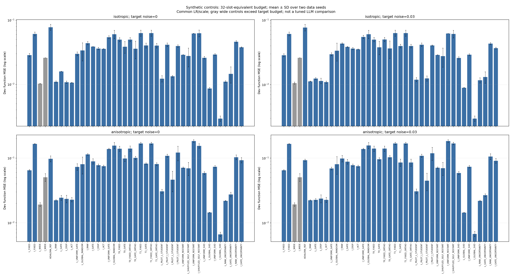

# Corrected synthetic controls

| Measured finding at average rank four | Evidence | Limit |
|---|---|---|
| Fixed standard LoRA has lower clean isotropic function error than fixed IniLoRA | MSE 0.028551 versus 0.061057 | Common LR/scale, one teacher and two data seeds; not tuned superiority. |
| IniLoRA global compression/recovery substantially changes the outcome | MSE 0.002922, versus fixed IniLoRA 0.061057 | Source width, refactorization, optimizer reset and recovery are combined; their separate causal contributions remain unmeasured. |
| No LLM method ranking follows from this toy task | All primary LLM tuning/independent screening remains pending | Synthetic allocation/compression behavior is a diagnostic. |

Completed 328 jobs / 984 fits, with 1272 verified adapter/optimizer stage checkpoints.

All 41 cells receive the same 100-update LR=0.01, scale=1 configuration at three feasible scalar budgets. Two data seeds share one fixed known teacher. This is a common-configuration diagnostic, not equally tuned performance and not a basis for selecting LLM finalists. Wide controls exceed target budget; reference AdaLoRA retains its native extra coefficients.

The CSV files preserve every seed, noise/covariance case, parameter count and rank map. The known-teacher covariance-weighted oracle is explicitly separate from learned methods. Repeated engineering executions are counted as cost, not independent seed replications.

Raw rows: `synthetic_v3.csv`; mean/SD/median: `synthetic_v3_summary.csv`; evidence/costs: `../artifacts/synthetic_v3_audit.json`.

At the 32-slot-equivalent budget, every registered cell is shown below. Values are mean ± sample SD over two data seeds; lower function error is better. Wide controls exceed the final budget, and faithful AdaLoRA retains its native E-scalar excess. Seed-level counts and all three budgets are in the CSV.

| Method | Isotropic clean | Isotropic noisy | Anisotropic clean | Anisotropic noisy |
|---|---:|---:|---:|---:|
| L_FIXED | 0.02855 ± 0.00157 | 0.02851 ± 0.00146 | 0.06470 ± 0.00151 | 0.06471 ± 0.00136 |
| I_FIXED | 0.06106 ± 0.00400 | 0.06109 ± 0.00400 | 0.16563 ± 0.00135 | 0.16564 ± 0.00132 |
| L_WIDE | 0.01022 ± 0.00007 | 0.01058 ± 0.00037 | 0.01917 ± 0.00127 | 0.01925 ± 0.00116 |
| I_WIDE | 0.02592 ± 0.00002 | 0.02601 ± 0.00001 | 0.05041 ± 0.00679 | 0.05049 ± 0.00680 |
| ADALORA_REF | 0.07761 ± 0.00806 | 0.07678 ± 0.00887 | 0.09764 ± 0.00992 | 0.09294 ± 0.00333 |
| L_RAW | 0.01091 ± 0.00036 | 0.01125 ± 0.00010 | 0.02229 ± 0.00042 | 0.02234 ± 0.00035 |
| L_GATE | 0.01589 ± 0.00005 | 0.01241 ± 0.00037 | 0.02438 ± 0.00207 | 0.02263 ± 0.00100 |
| L_DISP | 0.01078 ± 0.00043 | 0.01141 ± 0.00113 | 0.02345 ± 0.00311 | 0.02370 ± 0.00334 |
| L_ACT | 0.01058 ± 0.00011 | 0.01092 ± 0.00040 | 0.02276 ± 0.00170 | 0.02271 ± 0.00196 |
| L_UNIFORM_GATE | 0.02990 ± 0.00200 | 0.02961 ± 0.00145 | 0.07313 ± 0.00846 | 0.06919 ± 0.00330 |
| L_GLOBAL_RANDOM | 0.03366 ± 0.01050 | 0.03347 ± 0.01034 | 0.08030 ± 0.02343 | 0.08061 ± 0.02433 |
| I_RAW | 0.04376 ± 0.00239 | 0.04333 ± 0.00101 | 0.11379 ± 0.00308 | 0.09829 ± 0.01096 |
| I_GATE | 0.03869 ± 0.00011 | 0.03840 ± 0.00065 | 0.08900 ± 0.00838 | 0.08799 ± 0.00689 |
| I_DISP | 0.03611 ± 0.00143 | 0.03612 ± 0.00140 | 0.07781 ± 0.00306 | 0.07785 ± 0.00306 |
| I_ACT | 0.03561 ± 0.00017 | 0.03524 ± 0.00038 | 0.07497 ± 0.00281 | 0.07501 ± 0.00282 |
| I_UNIFORM_GATE | 0.05414 ± 0.00275 | 0.05495 ± 0.00299 | 0.13843 ± 0.00298 | 0.13801 ± 0.00371 |
| I_GLOBAL_RANDOM | 0.06031 ± 0.00884 | 0.06038 ± 0.00883 | 0.15628 ± 0.01674 | 0.15633 ± 0.01672 |
| T0_FIXED | 0.04966 ± 0.00349 | 0.04989 ± 0.00375 | 0.13954 ± 0.01230 | 0.13997 ± 0.01305 |
| T0_GATE | 0.03844 ± 0.00793 | 0.03788 ± 0.00875 | 0.09831 ± 0.00994 | 0.09608 ± 0.00471 |
| T0_FIXED_ORTHO | 0.04980 ± 0.00355 | 0.04999 ± 0.00368 | 0.14013 ± 0.01315 | 0.14002 ± 0.01315 |
| T0_GATE_ORTHO | 0.03592 ± 0.01098 | 0.03642 ± 0.01091 | 0.10072 ± 0.00550 | 0.10304 ± 0.00575 |
| T1_FIXED | 0.06284 ± 0.00663 | 0.06291 ± 0.00665 | 0.16837 ± 0.00702 | 0.16844 ± 0.00706 |
| T1_GATE | 0.04023 ± 0.00348 | 0.03963 ± 0.00250 | 0.08197 ± 0.00223 | 0.08532 ± 0.01063 |
| T1_FIXED_ORTHO | 0.06284 ± 0.00663 | 0.06291 ± 0.00665 | 0.16837 ± 0.00702 | 0.16844 ± 0.00706 |
| T1_GATE_ORTHO | 0.04010 ± 0.00329 | 0.03963 ± 0.00250 | 0.08067 ± 0.00407 | 0.08532 ± 0.01063 |
| L_PILOT_L_STUDENT | 0.01225 ± 0.00136 | 0.01195 ± 0.00084 | 0.03057 ± 0.00224 | 0.03076 ± 0.00255 |
| L_PILOT_I_STUDENT | 0.04146 ± 0.00257 | 0.04152 ± 0.00253 | 0.10858 ± 0.00569 | 0.10859 ± 0.00573 |
| I_PILOT_L_STUDENT | 0.01331 ± 0.00038 | 0.01246 ± 0.00114 | 0.04625 ± 0.01609 | 0.04487 ± 0.01353 |
| I_PILOT_I_STUDENT | 0.03943 ± 0.00167 | 0.04042 ± 0.00064 | 0.12141 ± 0.03049 | 0.11896 ± 0.02702 |
| L_UNIFORM_RESTART | 0.02886 ± 0.00002 | 0.02886 ± 0.00007 | 0.07094 ± 0.00180 | 0.07091 ± 0.00191 |
| L_SHUFFLED_SELF_RESTART | 0.02767 ± 0.00899 | 0.02770 ± 0.00905 | 0.06955 ± 0.01577 | 0.06982 ± 0.01577 |
| I_UNIFORM_RESTART | 0.06199 ± 0.00010 | 0.06202 ± 0.00004 | 0.18353 ± 0.00800 | 0.18351 ± 0.00797 |
| I_SHUFFLED_SELF_RESTART | 0.06250 ± 0.00735 | 0.06111 ± 0.00806 | 0.15450 ± 0.01228 | 0.16804 ± 0.00691 |
| L_UNIFORM_SVD | 0.02594 ± 0.00114 | 0.02594 ± 0.00105 | 0.05864 ± 0.00275 | 0.05879 ± 0.00314 |
| L_GLOBAL_SVD | 0.00862 ± 0.00029 | 0.00895 ± 0.00006 | 0.01440 ± 0.00012 | 0.01439 ± 0.00008 |
| I_UNIFORM_SVD | 0.02908 ± 0.00085 | 0.02910 ± 0.00095 | 0.07352 ± 0.00295 | 0.07359 ± 0.00300 |
| I_GLOBAL_SVD | 0.00292 ± 0.00027 | 0.00298 ± 0.00028 | 0.00662 ± 0.00053 | 0.00674 ± 0.00063 |
| L_RAW_UNCERTAINTY | 0.01100 ± 0.00030 | 0.01169 ± 0.00107 | 0.02183 ± 0.00036 | 0.02187 ± 0.00042 |
| L_GATE_UNCERTAINTY | 0.01455 ± 0.00408 | 0.01315 ± 0.00263 | 0.02737 ± 0.00221 | 0.02673 ± 0.00125 |
| I_RAW_UNCERTAINTY | 0.04594 ± 0.00188 | 0.04317 ± 0.00142 | 0.10308 ± 0.00847 | 0.10581 ± 0.01049 |
| I_GATE_UNCERTAINTY | 0.03778 ± 0.00060 | 0.03677 ± 0.00119 | 0.09268 ± 0.00868 | 0.09104 ± 0.00767 |

Signed deletion, finite-difference curvature, gauge and interacting-group diagnostics remain pending. Two data seeds have low power and do not establish broad method superiority.
