# DoRA initialization study

All registered families are retained in the CSV and JSON outputs, including failed or unavailable cells. Means and sample standard deviations use seeds 42, 43, and 44. The fixed-rate lane still tunes initializer settings; the joint lane tunes initializer and learning rate using validation only. Three-seed results require every seed; failed seeds are never silently removed. Test examples are rescored from retained predictions.

Differences are percentage points (nDCG ×100, Aircraft macro accuracy, or ViGGO JSON exact match). Exploratory 95% intervals use 10,000 crossed paired seed/example bootstrap draws, with class stratification and equal class weighting for Aircraft. They have no multiplicity correction. SciFact transfer uses NFCorpus-trained fits. Dense dequantized LoftQ timings do not measure compressed serving.

The displayed families were declared in source before main-result inspection. They cover 14 literature recipe parents plus four random anchors; no test-score ranking selects the display. All warm-start and quantized families are displayed separately. Literature rows retain the frozen registry interpretation and adaptation boundaries.

## centered/aircraft

Audit: `26c039c4a1602b4ec643250455c21e135c12a66168c7053503a6f32e5d97699a`. Test examples: 3333.

| Family | Fixed rate mean ± SD | Joint validation tuning mean ± SD |
|---|---:|---:|
| accepted_anchor | 56.27 ± 0.74 | 56.27 ± 0.74 |
| accepted_gaussian_scale | 56.76 ± 0.27 | 56.76 ± 0.27 |
| normal_up | 58.68 ± 0.66 | 58.68 ± 0.66 |
| lora_kaiming_uniform_down | 60.77 ± 0.09 | 60.77 ± 0.09 |
| pissa | 61.90 ± 1.11 | 61.90 ± 1.11 |
| milora | 60.77 ± 0.72 | 60.77 ± 0.72 |
| olora | 60.88 ± 0.71 | 60.88 ± 0.71 |
| eva | 61.58 ± 0.50 | 61.58 ± 0.50 |
| corda_ipm | 52.72 ± 1.85 | 58.94 ± 1.34 |
| astra_tail | 61.09 ± 0.07 | 61.09 ± 0.07 |
| loraga_ArB2r | 62.11 ± 0.73 | 62.11 ± 0.73 |
| loraone_centered | 61.05 ± 0.63 | 61.05 ± 0.63 |
| filet | 60.80 ± 0.45 | 60.80 ± 0.45 |
| lorada_centered | 60.58 ± 0.39 | 60.58 ± 0.39 |
| cntlora_cross_centered | 61.46 ± 0.87 | 61.46 ± 0.87 |
| inilora_prefit | 62.23 ± 0.81 | 62.23 ± 0.81 |
| tlora_init_only | 61.88 ± 0.64 | 61.88 ± 0.64 |
| mica_init_only | 60.31 ± 0.25 | 60.31 ± 0.25 |

| Joint-tuned family | Δ vs accepted [95% CI] | Δ vs scale-tuned Gaussian [95% CI] |
|---|---:|---:|
| accepted_anchor | +0.00 [+0.00, +0.00] | -0.49 [-1.86, +0.86] |
| accepted_gaussian_scale | +0.49 [-0.86, +1.86] | +0.00 [+0.00, +0.00] |
| normal_up | +2.41 [+0.92, +3.94] | +1.92 [+0.61, +3.22] |
| lora_kaiming_uniform_down | +4.50 [+3.09, +5.93] | +4.01 [+2.91, +5.15] |
| pissa | +5.63 [+4.12, +7.23] | +5.14 [+3.42, +6.78] |
| milora | +4.50 [+3.25, +5.83] | +4.01 [+2.70, +5.36] |
| olora | +4.61 [+3.45, +5.78] | +4.12 [+2.70, +5.55] |
| eva | +5.31 [+4.15, +6.49] | +4.83 [+3.52, +6.15] |
| corda_ipm | +2.67 [+0.99, +4.46] | +2.18 [+0.30, +3.95] |
| astra_tail | +4.83 [+3.48, +6.22] | +4.34 [+3.24, +5.47] |
| loraga_ArB2r | +5.84 [+4.22, +7.45] | +5.35 [+4.03, +6.71] |
| loraone_centered | +4.78 [+3.27, +6.35] | +4.29 [+3.02, +5.58] |
| filet | +4.54 [+3.21, +5.88] | +4.05 [+2.78, +5.32] |
| lorada_centered | +4.31 [+2.92, +5.74] | +3.83 [+2.59, +5.06] |
| cntlora_cross_centered | +5.19 [+3.63, +6.81] | +4.70 [+3.28, +6.16] |
| inilora_prefit | +5.97 [+4.52, +7.50] | +5.48 [+3.99, +6.89] |
| tlora_init_only | +5.62 [+4.38, +6.89] | +5.13 [+3.73, +6.53] |
| mica_init_only | +4.04 [+2.60, +5.54] | +3.55 [+2.47, +4.62] |

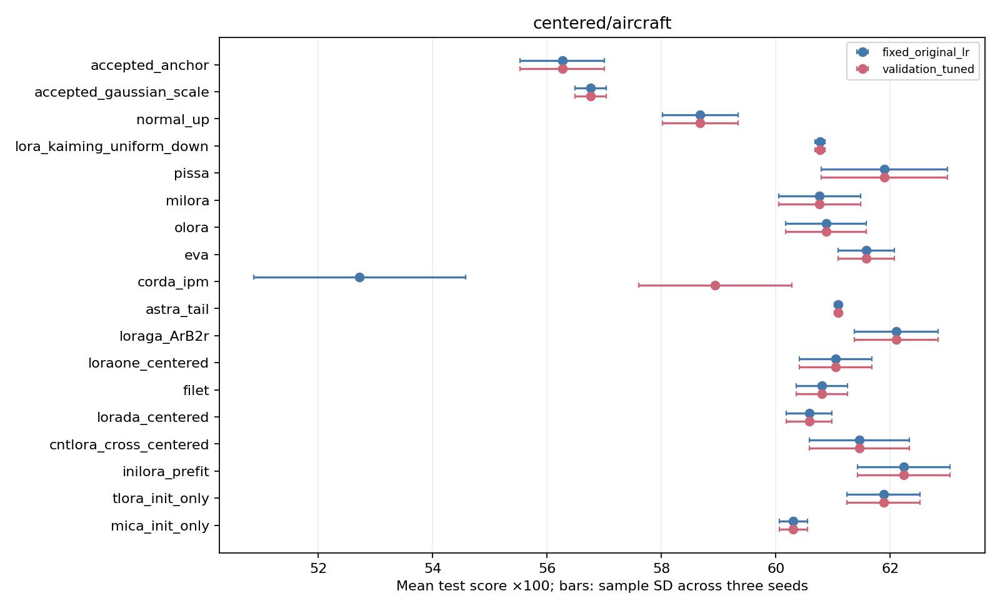

## centered/extraction

Audit: `859db095441d9751d07a07c38f5745383a1df8024b6ca1b1f0524e02c28a2357`. Test examples: 256.

| Family | Fixed rate mean ± SD | Joint validation tuning mean ± SD |
|---|---:|---:|
| accepted_anchor | 73.83 ± 2.95 | 73.83 ± 2.95 |
| accepted_gaussian_scale | 73.83 ± 2.95 | 67.45 ± 6.25 |
| normal_up | 69.27 ± 0.98 | 69.27 ± 0.98 |
| lora_kaiming_uniform_down | 72.53 ± 1.37 | 72.53 ± 1.37 |
| pissa | 70.57 ± 1.19 | 70.57 ± 1.19 |
| milora | 74.87 ± 3.25 | 74.87 ± 3.25 |
| olora | 77.34 ± 1.70 | 77.34 ± 1.70 |
| eva | 72.92 ± 3.79 | 72.92 ± 3.79 |
| corda_ipm | 45.70 ± 9.09 | 45.70 ± 9.09 |
| astra_tail | 72.92 ± 3.85 | 72.92 ± 3.85 |
| loraga_ArB2r | 73.05 ± 3.58 | 73.05 ± 3.58 |
| loraone_centered | 72.66 ± 1.03 | 72.66 ± 1.03 |
| filet | 62.37 ± 0.90 | 62.37 ± 0.90 |
| lorada_centered | 62.37 ± 2.29 | 62.37 ± 2.29 |
| cntlora_cross_centered | 72.01 ± 0.60 | 72.01 ± 0.60 |
| inilora_prefit | 75.13 ± 2.39 | 75.13 ± 2.39 |
| tlora_init_only | 74.74 ± 6.31 | 74.74 ± 6.31 |
| mica_init_only | 52.21 ± 5.64 | 52.21 ± 5.64 |

| Joint-tuned family | Δ vs accepted [95% CI] | Δ vs scale-tuned Gaussian [95% CI] |
|---|---:|---:|
| accepted_anchor | +0.00 [+0.00, +0.00] | +6.38 [-2.73, +14.97] |
| accepted_gaussian_scale | -6.38 [-14.97, +2.73] | +0.00 [+0.00, +0.00] |
| normal_up | -4.56 [-10.16, +0.91] | +1.82 [-6.90, +10.03] |
| lora_kaiming_uniform_down | -1.30 [-7.42, +5.08] | +5.08 [-3.00, +13.54] |
| pissa | -3.26 [-9.11, +2.86] | +3.12 [-5.08, +11.46] |
| milora | +1.04 [-5.99, +8.59] | +7.42 [+1.43, +13.28] |
| olora | +3.52 [-1.95, +9.64] | +9.90 [+2.99, +16.67] |
| eva | -0.91 [-7.81, +6.25] | +5.47 [-0.26, +11.46] |
| corda_ipm | -28.12 [-38.41, -16.14] | -21.74 [-28.12, -15.36] |
| astra_tail | -0.91 [-8.72, +7.42] | +5.47 [-0.78, +11.85] |
| loraga_ArB2r | -0.78 [-7.81, +6.77] | +5.60 [+0.00, +11.59] |
| loraone_centered | -1.17 [-6.77, +4.43] | +5.21 [-3.39, +13.54] |
| filet | -11.46 [-17.45, -5.34] | -5.08 [-13.15, +2.21] |
| lorada_centered | -11.46 [-17.45, -5.47] | -5.08 [-15.11, +4.04] |
| cntlora_cross_centered | -1.82 [-7.94, +4.69] | +4.56 [-3.39, +12.24] |
| inilora_prefit | +1.30 [-5.08, +8.20] | +7.68 [-1.04, +16.80] |
| tlora_init_only | +0.91 [-7.42, +9.77] | +7.29 [+1.82, +12.76] |
| mica_init_only | -21.61 [-29.43, -13.67] | -15.23 [-22.14, -8.59] |

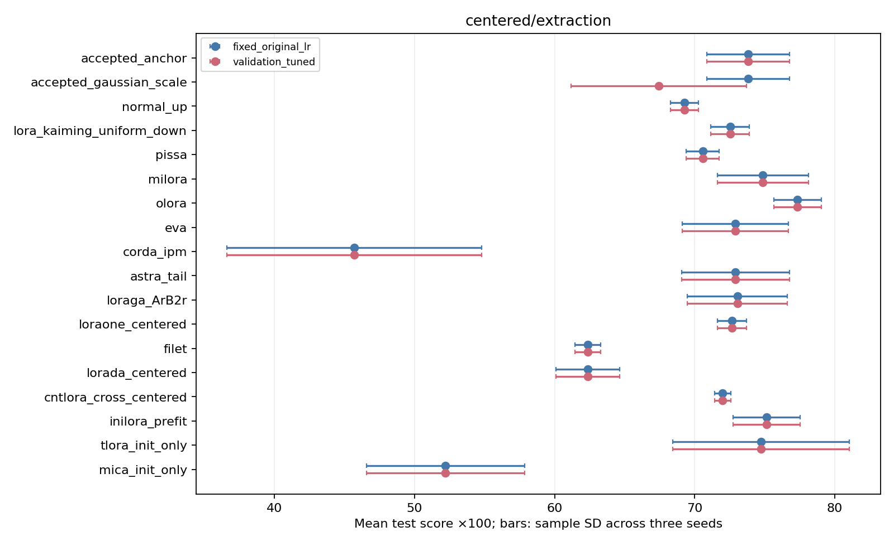

## centered/nfcorpus

Audit: `9f025b1fd47899ecd44532168e60995791cfbc76f0e35c1d55b01cfed3062a73`. Test examples: 323.

| Family | Fixed rate mean ± SD | Joint validation tuning mean ± SD |
|---|---:|---:|
| accepted_anchor | 32.02 ± 0.24 | 32.02 ± 0.24 |
| accepted_gaussian_scale | 31.82 ± 0.27 | 31.82 ± 0.27 |
| normal_up | 32.31 ± 0.05 | 32.16 ± 0.03 |
| lora_kaiming_uniform_down | 31.32 ± 0.25 | 32.09 ± 0.08 |
| pissa | 31.31 ± 0.19 | 32.11 ± 0.15 |
| milora | 31.42 ± 0.17 | 32.11 ± 0.09 |
| olora | 30.91 ± 0.20 | 32.30 ± 0.30 |
| eva | 31.66 ± 0.19 | 32.16 ± 0.21 |
| corda_ipm | 31.70 ± 0.53 | 31.70 ± 0.53 |
| astra_tail | 31.55 ± 0.10 | 32.03 ± 0.12 |
| loraga_ArB2r | 31.69 ± 0.37 | 31.89 ± 0.30 |
| loraone_centered | 30.76 ± 0.17 | 32.13 ± 0.03 |
| filet | 30.82 ± 0.13 | 32.14 ± 0.18 |
| lorada_centered | 31.12 ± 0.05 | 32.15 ± 0.11 |
| cntlora_cross_centered | 31.79 ± 0.22 | 31.79 ± 0.22 |
| inilora_prefit | 30.35 ± 0.38 | 32.20 ± 0.29 |
| tlora_init_only | 32.08 ± 0.27 | 32.21 ± 0.20 |
| mica_init_only | 31.75 ± 0.20 | 32.04 ± 0.22 |

| Joint-tuned family | Δ vs accepted [95% CI] | Δ vs scale-tuned Gaussian [95% CI] |
|---|---:|---:|
| accepted_anchor | +0.00 [+0.00, +0.00] | +0.19 [-0.40, +0.77] |
| accepted_gaussian_scale | -0.19 [-0.77, +0.40] | +0.00 [+0.00, +0.00] |
| normal_up | +0.14 [-0.80, +1.06] | +0.33 [-0.58, +1.27] |
| lora_kaiming_uniform_down | +0.07 [-0.81, +0.91] | +0.26 [-0.58, +1.08] |
| pissa | +0.10 [-1.11, +1.39] | +0.29 [-0.86, +1.50] |
| milora | +0.09 [-0.83, +0.92] | +0.29 [-0.59, +1.10] |
| olora | +0.28 [-0.77, +1.34] | +0.48 [-0.50, +1.51] |
| eva | +0.14 [-0.79, +1.08] | +0.34 [-0.47, +1.15] |
| corda_ipm | -0.32 [-1.71, +1.03] | -0.12 [-1.43, +1.18] |
| astra_tail | +0.01 [-0.86, +0.82] | +0.20 [-0.65, +0.99] |
| loraga_ArB2r | -0.13 [-1.11, +0.82] | +0.07 [-0.82, +0.91] |
| loraone_centered | +0.11 [-0.78, +0.94] | +0.31 [-0.55, +1.13] |
| filet | +0.12 [-0.82, +1.00] | +0.31 [-0.64, +1.21] |
| lorada_centered | +0.13 [-0.78, +0.98] | +0.33 [-0.56, +1.16] |
| cntlora_cross_centered | -0.23 [-1.20, +0.72] | -0.03 [-0.94, +0.88] |
| inilora_prefit | +0.18 [-0.88, +1.33] | +0.38 [-0.67, +1.53] |
| tlora_init_only | +0.19 [-0.77, +1.20] | +0.38 [-0.49, +1.31] |
| mica_init_only | +0.02 [-0.84, +0.82] | +0.21 [-0.60, +0.94] |

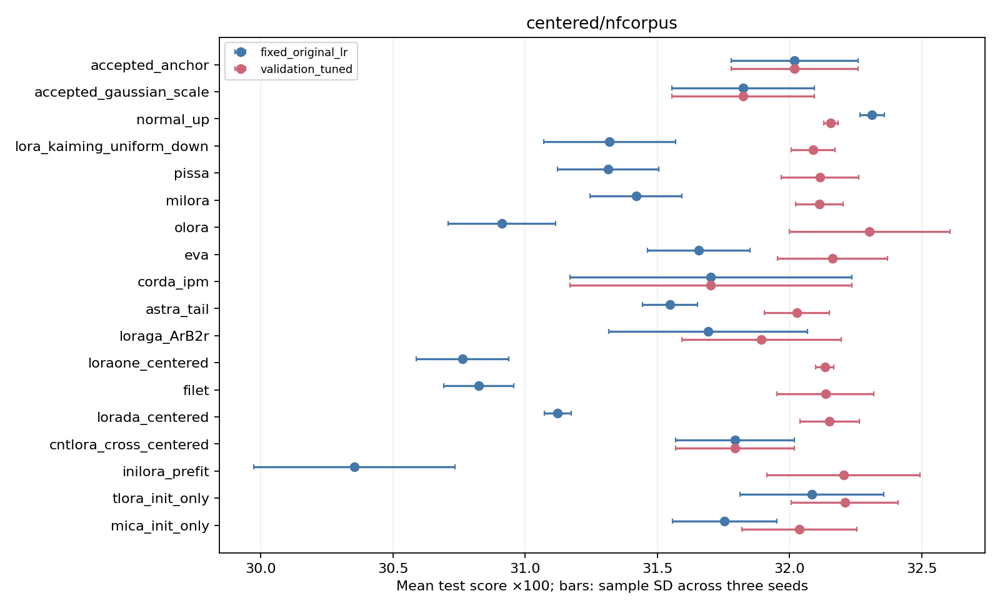

## centered/scifact_transfer

Audit: `9f025b1fd47899ecd44532168e60995791cfbc76f0e35c1d55b01cfed3062a73`. Test examples: 300.

| Family | Fixed rate mean ± SD | Joint validation tuning mean ± SD |
|---|---:|---:|
| accepted_anchor | 63.53 ± 0.24 | 63.53 ± 0.24 |
| accepted_gaussian_scale | 63.02 ± 0.91 | 63.02 ± 0.91 |
| normal_up | 63.97 ± 0.60 | 62.26 ± 0.60 |
| lora_kaiming_uniform_down | 63.13 ± 0.42 | 62.05 ± 0.39 |
| pissa | 58.60 ± 0.18 | 58.69 ± 0.58 |
| milora | 63.36 ± 0.14 | 62.64 ± 0.48 |
| olora | 62.56 ± 0.16 | 62.53 ± 0.76 |
| eva | 63.66 ± 0.59 | 63.06 ± 0.35 |
| corda_ipm | 57.31 ± 0.40 | 57.31 ± 0.40 |
| astra_tail | 63.76 ± 0.30 | 62.63 ± 0.39 |
| loraga_ArB2r | 62.01 ± 0.93 | 63.07 ± 1.19 |
| loraone_centered | 63.01 ± 0.35 | 62.17 ± 0.72 |
| filet | 63.31 ± 0.28 | 62.10 ± 0.31 |
| lorada_centered | 62.98 ± 0.13 | 61.74 ± 0.39 |
| cntlora_cross_centered | 63.48 ± 0.57 | 63.48 ± 0.57 |
| inilora_prefit | 62.06 ± 1.28 | 59.59 ± 1.87 |
| tlora_init_only | 64.43 ± 0.55 | 62.45 ± 0.53 |
| mica_init_only | 63.85 ± 0.02 | 63.24 ± 0.53 |

| Joint-tuned family | Δ vs accepted [95% CI] | Δ vs scale-tuned Gaussian [95% CI] |
|---|---:|---:|
| accepted_anchor | +0.00 [+0.00, +0.00] | +0.51 [-0.64, +1.70] |
| accepted_gaussian_scale | -0.51 [-1.70, +0.64] | +0.00 [+0.00, +0.00] |
| normal_up | -1.27 [-2.92, +0.35] | -0.76 [-2.45, +1.03] |
| lora_kaiming_uniform_down | -1.48 [-3.40, +0.44] | -0.97 [-3.24, +1.33] |
| pissa | -4.84 [-7.36, -2.39] | -4.33 [-7.16, -1.74] |
| milora | -0.89 [-2.68, +0.88] | -0.38 [-2.35, +1.65] |
| olora | -1.00 [-2.86, +0.80] | -0.49 [-2.48, +1.58] |
| eva | -0.47 [-2.32, +1.45] | +0.04 [-2.06, +2.29] |
| corda_ipm | -6.21 [-8.70, -3.72] | -5.71 [-8.07, -3.29] |
| astra_tail | -0.89 [-2.64, +0.86] | -0.39 [-2.43, +1.68] |
| loraga_ArB2r | -0.46 [-2.51, +1.57] | +0.05 [-2.12, +2.31] |
| loraone_centered | -1.36 [-3.30, +0.58] | -0.85 [-3.09, +1.51] |
| filet | -1.43 [-3.25, +0.36] | -0.92 [-2.99, +1.13] |
| lorada_centered | -1.79 [-3.70, +0.10] | -1.28 [-3.52, +0.95] |
| cntlora_cross_centered | -0.05 [-1.62, +1.52] | +0.46 [-1.25, +2.21] |
| inilora_prefit | -3.94 [-6.67, -1.36] | -3.43 [-5.87, -1.12] |
| tlora_init_only | -1.08 [-2.97, +0.84] | -0.57 [-2.65, +1.58] |
| mica_init_only | -0.29 [-1.77, +1.24] | +0.22 [-1.40, +1.93] |

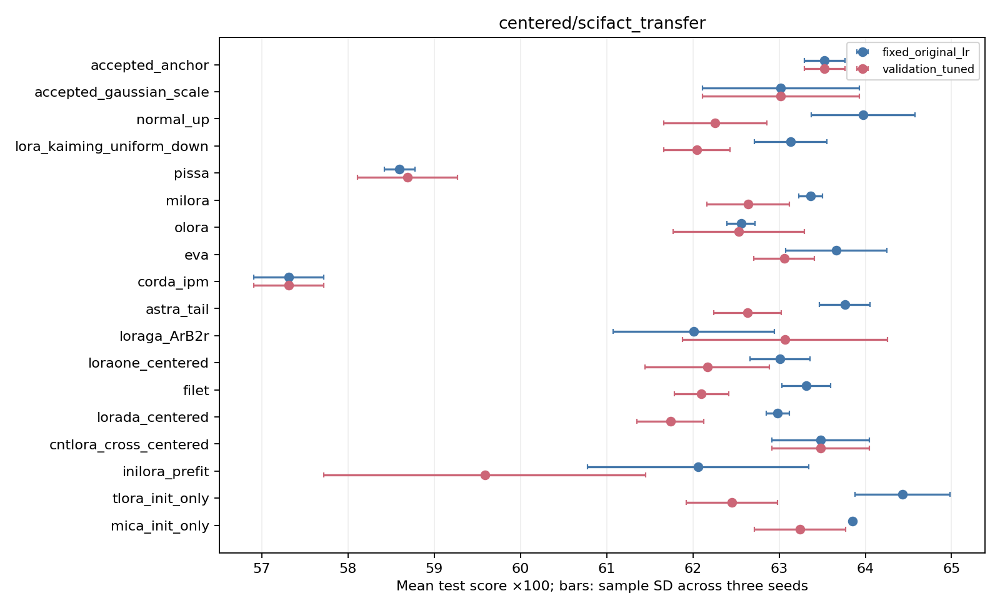

## centered/scifact

Audit: `621e3cad59601f53507e6e7cdcdbdd4f5e9173069f4473e93283f909c58cc714`. Test examples: 300.

| Family | Fixed rate mean ± SD | Joint validation tuning mean ± SD |
|---|---:|---:|
| accepted_anchor | 67.99 ± 0.64 | 67.99 ± 0.64 |
| accepted_gaussian_scale | 69.01 ± 0.62 | 69.01 ± 0.62 |
| normal_up | 69.51 ± 1.17 | 69.51 ± 1.17 |
| lora_kaiming_uniform_down | 66.03 ± 0.39 | 66.03 ± 0.39 |
| pissa | 70.57 ± 0.52 | 70.57 ± 0.52 |
| milora | 65.54 ± 0.18 | 65.54 ± 0.18 |
| olora | 69.75 ± 0.28 | 69.75 ± 0.28 |
| eva | 69.36 ± 0.38 | 69.36 ± 0.38 |
| corda_ipm | 68.67 ± 0.58 | 68.67 ± 0.58 |
| astra_tail | 66.63 ± 0.70 | 66.63 ± 0.70 |
| loraga_ArB2r | 70.16 ± 0.19 | 70.16 ± 0.19 |
| loraone_centered | 66.23 ± 0.41 | 66.23 ± 0.41 |
| filet | 65.68 ± 0.16 | 65.68 ± 0.16 |
| lorada_centered | 65.68 ± 0.56 | 65.68 ± 0.56 |
| cntlora_cross_centered | 67.80 ± 0.33 | 67.80 ± 0.33 |
| inilora_prefit | 68.01 ± 0.56 | 68.01 ± 0.56 |
| tlora_init_only | 69.46 ± 0.29 | 69.46 ± 0.29 |
| mica_init_only | 66.84 ± 0.61 | 66.84 ± 0.61 |

| Joint-tuned family | Δ vs accepted [95% CI] | Δ vs scale-tuned Gaussian [95% CI] |
|---|---:|---:|
| accepted_anchor | +0.00 [+0.00, +0.00] | -1.03 [-2.27, +0.06] |
| accepted_gaussian_scale | +1.03 [-0.06, +2.27] | +0.00 [+0.00, +0.00] |
| normal_up | +1.52 [-0.10, +3.34] | +0.49 [-1.25, +2.31] |
| lora_kaiming_uniform_down | -1.96 [-3.52, -0.38] | -2.99 [-5.12, -0.92] |
| pissa | +2.58 [+1.05, +4.25] | +1.55 [-0.20, +3.40] |
| milora | -2.45 [-4.20, -0.68] | -3.47 [-5.55, -1.46] |
| olora | +1.76 [+0.26, +3.39] | +0.73 [-0.94, +2.62] |
| eva | +1.37 [-0.16, +2.92] | +0.34 [-1.31, +1.94] |
| corda_ipm | +0.69 [-1.38, +2.76] | -0.34 [-2.23, +1.62] |
| astra_tail | -1.35 [-3.04, +0.31] | -2.38 [-4.60, -0.27] |
| loraga_ArB2r | +2.18 [+0.53, +3.86] | +1.15 [-0.45, +2.76] |
| loraone_centered | -1.75 [-3.53, -0.07] | -2.78 [-4.86, -0.76] |
| filet | -2.30 [-4.09, -0.51] | -3.33 [-5.47, -1.25] |
| lorada_centered | -2.31 [-4.23, -0.42] | -3.33 [-5.44, -1.25] |
| cntlora_cross_centered | -0.19 [-1.72, +1.40] | -1.21 [-3.00, +0.66] |
| inilora_prefit | +0.02 [-1.52, +1.62] | -1.00 [-3.12, +1.03] |
| tlora_init_only | +1.48 [-0.16, +3.11] | +0.45 [-1.27, +2.18] |
| mica_init_only | -1.15 [-2.80, +0.46] | -2.17 [-4.27, -0.19] |

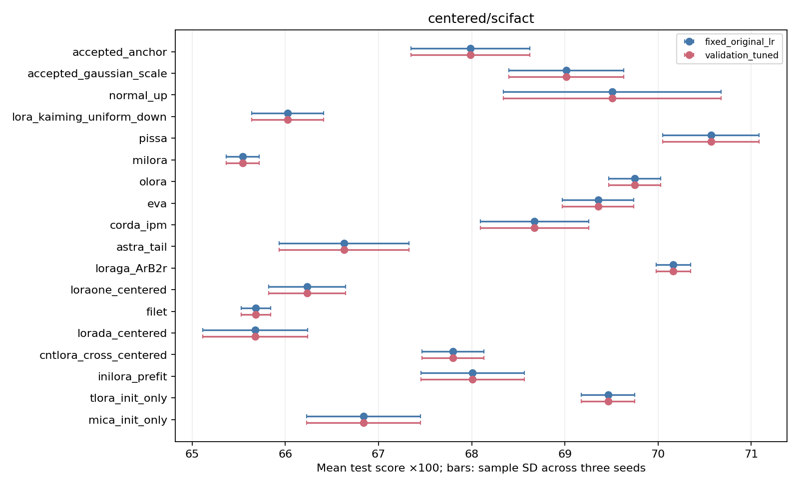

## quantized/aircraft

Audit: `8064b84a748051e69ddd74ad7afba7ca8790c57b7540747a3bbb0f1390213f01`. Test examples: 3333.

| Family | Fixed rate mean ± SD | Joint validation tuning mean ± SD |
|---|---:|---:|
| accepted_anchor | 56.27 ± 0.74 | 56.27 ± 0.74 |
| loftq_i1_original | 60.14 ± 0.55 | 60.14 ± 0.55 |
| loftq_i1_quantized | 60.47 ± 0.50 | 60.47 ± 0.50 |
| loftq_i3_original | 60.47 ± 0.79 | 60.47 ± 0.79 |
| loftq_i3_quantized | 60.16 ± 0.28 | 60.16 ± 0.28 |
| nf4_control_i1_original | all_pilots_failed | all_pilots_failed |
| nf4_control_i1_quantized | all_pilots_failed | all_pilots_failed |
| nf4_control_i3_original | all_pilots_failed | all_pilots_failed |
| nf4_control_i3_quantized | all_pilots_failed | all_pilots_failed |

| Joint-tuned family | Δ vs accepted [95% CI] | Δ vs scale-tuned Gaussian [95% CI] |
|---|---:|---:|
| accepted_anchor | +0.00 [+0.00, +0.00] | -0.49 [-1.86, +0.86] |
| loftq_i1_original | +3.87 [+2.71, +5.07] | +3.38 [+2.08, +4.73] |
| loftq_i1_quantized | +4.21 [+2.81, +5.70] | +3.72 [+2.55, +4.87] |
| loftq_i3_original | +4.20 [+2.61, +5.91] | +3.71 [+2.49, +4.94] |
| loftq_i3_quantized | +3.89 [+2.61, +5.22] | +3.41 [+2.29, +4.55] |
| nf4_control_i1_original | unavailable_failed_or_missing_fit | unavailable_failed_or_missing_fit |
| nf4_control_i1_quantized | unavailable_failed_or_missing_fit | unavailable_failed_or_missing_fit |
| nf4_control_i3_original | unavailable_failed_or_missing_fit | unavailable_failed_or_missing_fit |
| nf4_control_i3_quantized | unavailable_failed_or_missing_fit | unavailable_failed_or_missing_fit |

| Joint-tuned LoftQ | Δ vs identical-base, same-LR NF4 control [95% CI] |
|---|---:|
| loftq_i1_original | unavailable_failed_or_missing_fit |
| loftq_i1_quantized | unavailable_failed_or_missing_fit |
| loftq_i3_original | unavailable_failed_or_missing_fit |
| loftq_i3_quantized | unavailable_failed_or_missing_fit |

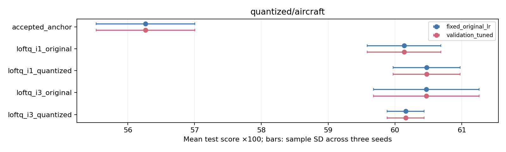

## quantized/extraction

Audit: `e58756815f7444671dbb136766444f6f46ab579bd0a61c5bcefe588643944e6c`. Test examples: 256.

| Family | Fixed rate mean ± SD | Joint validation tuning mean ± SD |
|---|---:|---:|
| accepted_anchor | 73.83 ± 2.95 | 73.83 ± 2.95 |
| nf4_control_i1_original | all_pilots_failed | all_pilots_failed |
| loftq_i1_original | 69.01 ± 2.15 | 69.01 ± 2.15 |
| nf4_control_i1_quantized | all_pilots_failed | all_pilots_failed |
| loftq_i1_quantized | 68.75 ± 1.70 | 68.75 ± 1.70 |
| nf4_control_i3_original | all_pilots_failed | all_pilots_failed |
| loftq_i3_original | 72.14 ± 0.81 | 72.14 ± 0.81 |
| nf4_control_i3_quantized | all_pilots_failed | all_pilots_failed |
| loftq_i3_quantized | 67.97 ± 4.50 | 67.97 ± 4.50 |

| Joint-tuned family | Δ vs accepted [95% CI] | Δ vs scale-tuned Gaussian [95% CI] |
|---|---:|---:|
| accepted_anchor | +0.00 [+0.00, +0.00] | +6.38 [-2.73, +14.97] |
| nf4_control_i1_original | unavailable_failed_or_missing_fit | unavailable_failed_or_missing_fit |
| loftq_i1_original | -4.82 [-10.55, +1.17] | +1.56 [-8.20, +11.20] |
| nf4_control_i1_quantized | unavailable_failed_or_missing_fit | unavailable_failed_or_missing_fit |
| loftq_i1_quantized | -5.08 [-10.68, +0.78] | +1.30 [-7.81, +10.16] |
| nf4_control_i3_original | unavailable_failed_or_missing_fit | unavailable_failed_or_missing_fit |
| loftq_i3_original | -1.69 [-8.07, +4.82] | +4.69 [-2.73, +12.50] |
| nf4_control_i3_quantized | unavailable_failed_or_missing_fit | unavailable_failed_or_missing_fit |
| loftq_i3_quantized | -5.86 [-14.84, +2.73] | +0.52 [-7.81, +9.38] |

| Joint-tuned LoftQ | Δ vs identical-base, same-LR NF4 control [95% CI] |
|---|---:|
| loftq_i1_original | unavailable_failed_or_missing_fit |
| loftq_i1_quantized | unavailable_failed_or_missing_fit |
| loftq_i3_original | unavailable_failed_or_missing_fit |
| loftq_i3_quantized | unavailable_failed_or_missing_fit |

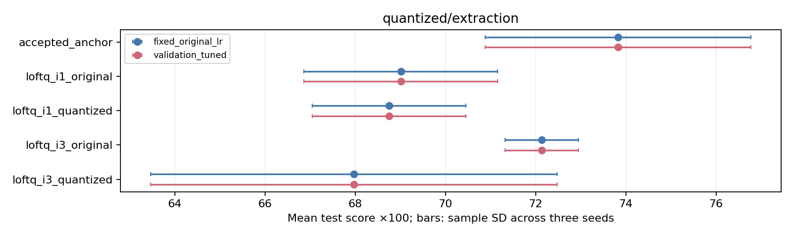

## quantized/nfcorpus

Audit: `327e5a97d9e286bd54f3787d2bd2442070b1869a4ae190f0e2c950816fbd4576`. Test examples: 323.

| Family | Fixed rate mean ± SD | Joint validation tuning mean ± SD |
|---|---:|---:|
| accepted_anchor | 32.02 ± 0.24 | 32.02 ± 0.24 |
| nf4_control_i1_original | 32.19 ± 0.24 | 32.19 ± 0.24 |
| loftq_i1_original | 30.51 ± 0.11 | 31.93 ± 0.09 |
| nf4_control_i1_quantized | 32.19 ± 0.33 | 32.19 ± 0.33 |
| loftq_i1_quantized | 30.40 ± 0.11 | 31.94 ± 0.11 |
| nf4_control_i3_original | 31.94 ± 0.23 | 31.94 ± 0.23 |
| loftq_i3_original | 30.52 ± 0.10 | 31.77 ± 0.11 |
| nf4_control_i3_quantized | 31.98 ± 0.22 | 31.98 ± 0.22 |
| loftq_i3_quantized | 30.47 ± 0.10 | 31.66 ± 0.10 |

| Joint-tuned family | Δ vs accepted [95% CI] | Δ vs scale-tuned Gaussian [95% CI] |
|---|---:|---:|
| accepted_anchor | +0.00 [+0.00, +0.00] | +0.19 [-0.40, +0.77] |
| nf4_control_i1_original | +0.17 [-0.17, +0.50] | +0.36 [-0.24, +0.97] |
| loftq_i1_original | -0.09 [-0.98, +0.76] | +0.11 [-0.72, +0.92] |
| nf4_control_i1_quantized | +0.17 [-0.17, +0.51] | +0.36 [-0.28, +1.00] |
| loftq_i1_quantized | -0.08 [-0.99, +0.77] | +0.11 [-0.72, +0.95] |
| nf4_control_i3_original | -0.08 [-0.46, +0.27] | +0.11 [-0.47, +0.68] |
| loftq_i3_original | -0.25 [-1.19, +0.71] | -0.05 [-0.94, +0.82] |
| nf4_control_i3_quantized | -0.04 [-0.43, +0.32] | +0.15 [-0.42, +0.71] |
| loftq_i3_quantized | -0.36 [-1.31, +0.53] | -0.16 [-1.07, +0.72] |

| Joint-tuned LoftQ | Δ vs identical-base, same-LR NF4 control [95% CI] |
|---|---:|
| loftq_i1_original | +0.11 [-0.93, +1.10] |
| loftq_i1_quantized | +0.11 [-0.97, +1.14] |
| loftq_i3_original | +0.28 [-0.83, +1.40] |
| loftq_i3_quantized | +0.15 [-0.97, +1.27] |

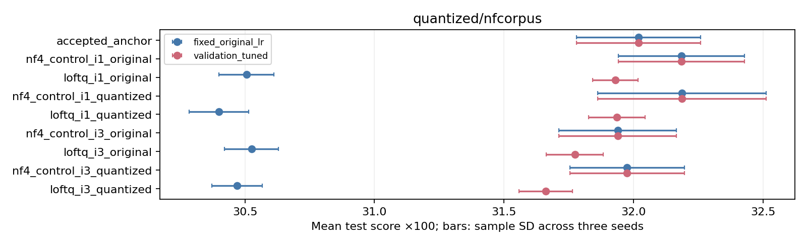

## quantized/scifact_transfer

Audit: `327e5a97d9e286bd54f3787d2bd2442070b1869a4ae190f0e2c950816fbd4576`. Test examples: 300.

| Family | Fixed rate mean ± SD | Joint validation tuning mean ± SD |
|---|---:|---:|
| accepted_anchor | 63.53 ± 0.24 | 63.53 ± 0.24 |
| nf4_control_i1_original | 62.79 ± 0.68 | 62.79 ± 0.68 |
| loftq_i1_original | 62.33 ± 0.19 | 61.91 ± 0.38 |
| nf4_control_i1_quantized | 62.82 ± 0.78 | 62.82 ± 0.78 |
| loftq_i1_quantized | 62.28 ± 0.19 | 61.98 ± 0.35 |
| nf4_control_i3_original | 63.42 ± 0.35 | 63.42 ± 0.35 |
| loftq_i3_original | 62.41 ± 0.34 | 62.56 ± 0.41 |
| nf4_control_i3_quantized | 63.30 ± 0.47 | 63.30 ± 0.47 |
| loftq_i3_quantized | 62.41 ± 0.16 | 62.87 ± 0.11 |

| Joint-tuned family | Δ vs accepted [95% CI] | Δ vs scale-tuned Gaussian [95% CI] |
|---|---:|---:|
| accepted_anchor | +0.00 [+0.00, +0.00] | +0.51 [-0.64, +1.70] |
| nf4_control_i1_original | -0.73 [-1.93, +0.35] | -0.23 [-1.57, +1.15] |
| loftq_i1_original | -1.62 [-3.45, +0.16] | -1.11 [-3.27, +0.95] |
| nf4_control_i1_quantized | -0.71 [-1.97, +0.51] | -0.20 [-1.61, +1.24] |
| loftq_i1_quantized | -1.55 [-3.32, +0.21] | -1.05 [-3.15, +1.02] |
| nf4_control_i3_original | -0.11 [-1.10, +0.88] | +0.40 [-1.08, +1.87] |
| loftq_i3_original | -0.97 [-2.91, +0.86] | -0.47 [-2.78, +1.74] |
| nf4_control_i3_quantized | -0.23 [-1.23, +0.77] | +0.28 [-1.13, +1.70] |
| loftq_i3_quantized | -0.66 [-2.46, +1.06] | -0.15 [-2.35, +1.89] |

| Joint-tuned LoftQ | Δ vs identical-base, same-LR NF4 control [95% CI] |
|---|---:|
| loftq_i1_original | +1.32 [-0.91, +3.65] |
| loftq_i1_quantized | +1.39 [-0.77, +3.67] |
| loftq_i3_original | +1.69 [-0.64, +3.97] |
| loftq_i3_quantized | +1.92 [-0.33, +4.16] |

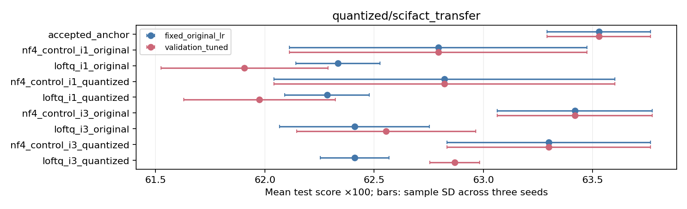

## quantized/scifact

Audit: `fc94e15bec0a6d506c88813ccd1c968477f943e9989cbc026ed2d215ba0ef55a`. Test examples: 300.

| Family | Fixed rate mean ± SD | Joint validation tuning mean ± SD |
|---|---:|---:|
| accepted_anchor | 67.99 ± 0.64 | 67.99 ± 0.64 |
| nf4_control_i1_original | 67.90 ± 0.55 | 67.90 ± 0.55 |
| loftq_i1_original | 66.69 ± 0.37 | 66.69 ± 0.37 |
| nf4_control_i1_quantized | 67.95 ± 0.57 | 67.95 ± 0.57 |
| loftq_i1_quantized | 66.61 ± 0.70 | 66.61 ± 0.70 |
| nf4_control_i3_original | 68.43 ± 0.46 | 68.43 ± 0.46 |
| loftq_i3_original | 67.41 ± 0.30 | 67.41 ± 0.30 |
| nf4_control_i3_quantized | 68.53 ± 0.60 | 68.53 ± 0.60 |
| loftq_i3_quantized | 67.49 ± 0.60 | 67.49 ± 0.60 |

| Joint-tuned family | Δ vs accepted [95% CI] | Δ vs scale-tuned Gaussian [95% CI] |
|---|---:|---:|
| accepted_anchor | +0.00 [+0.00, +0.00] | -1.03 [-2.27, +0.06] |
| nf4_control_i1_original | -0.09 [-1.04, +0.87] | -1.12 [-2.32, +0.04] |
| loftq_i1_original | -1.30 [-2.98, +0.37] | -2.32 [-4.55, -0.19] |
| nf4_control_i1_quantized | -0.04 [-0.97, +0.90] | -1.07 [-2.26, +0.07] |
| loftq_i1_quantized | -1.37 [-3.13, +0.40] | -2.40 [-4.75, -0.13] |
| nf4_control_i3_original | +0.45 [-0.40, +1.26] | -0.58 [-1.79, +0.55] |
| loftq_i3_original | -0.58 [-2.17, +1.09] | -1.60 [-3.71, +0.43] |
| nf4_control_i3_quantized | +0.55 [-0.37, +1.44] | -0.48 [-1.67, +0.65] |
| loftq_i3_quantized | -0.50 [-2.16, +1.29] | -1.53 [-3.73, +0.62] |

| Joint-tuned LoftQ | Δ vs identical-base, same-LR NF4 control [95% CI] |
|---|---:|
| loftq_i1_original | -1.21 [-3.02, +0.69] |
| loftq_i1_quantized | -1.33 [-3.27, +0.73] |
| loftq_i3_original | -1.02 [-2.66, +0.71] |
| loftq_i3_quantized | -1.05 [-2.88, +0.97] |

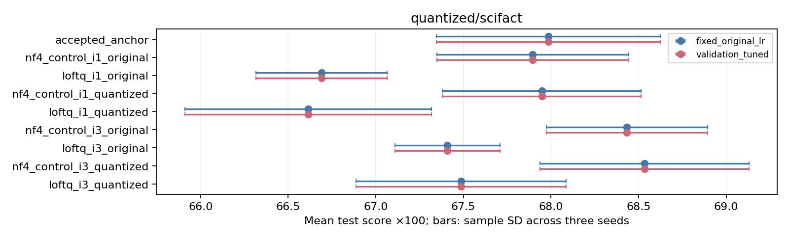

## warmstart/aircraft

Audit: `4378c777fdbd8cbcbb638b120bd6df93e1a71550dcffaab10eb116b2789613b9`. Test examples: 3333.

| Family | Fixed rate mean ± SD | Joint validation tuning mean ± SD |
|---|---:|---:|
| accepted_anchor | 56.27 ± 0.74 | 56.27 ± 0.74 |
| cntlora_cross_warm | 41.41 ± 2.50 | 41.41 ± 2.50 |
| cntlora_self_warm | 10.95 ± 0.66 | 10.95 ± 0.66 |
| cntlora_shift_warm | 33.15 ± 0.90 | 33.15 ± 0.90 |
| lorada_warm | 60.50 ± 0.64 | 60.50 ± 0.64 |
| loraone_warm | 60.96 ± 1.06 | 60.96 ± 1.06 |

| Joint-tuned family | Δ vs accepted [95% CI] | Δ vs scale-tuned Gaussian [95% CI] |
|---|---:|---:|
| accepted_anchor | +0.00 [+0.00, +0.00] | -0.49 [-1.86, +0.86] |
| cntlora_cross_warm | -14.86 [-17.01, -12.72] | -15.35 [-18.13, -12.45] |
| cntlora_self_warm | -45.32 [-46.82, -43.78] | -45.81 [-47.39, -44.20] |
| cntlora_shift_warm | -23.12 [-24.52, -21.66] | -23.61 [-25.34, -21.82] |
| lorada_warm | +4.24 [+2.83, +5.70] | +3.75 [+2.40, +5.10] |
| loraone_warm | +4.69 [+2.98, +6.51] | +4.20 [+2.69, +5.77] |

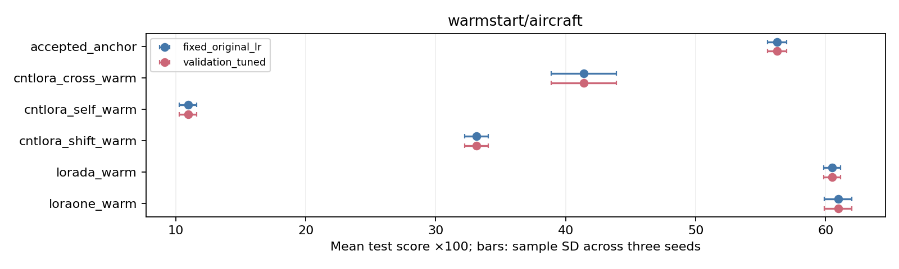

## warmstart/extraction

Audit: `6fff81e96192e9c2f6235412bd0226991a1e77833c557ffd310c31eaa884aac5`. Test examples: 256.

| Family | Fixed rate mean ± SD | Joint validation tuning mean ± SD |
|---|---:|---:|
| accepted_anchor | 73.83 ± 2.95 | 73.83 ± 2.95 |
| loraone_warm | 71.48 ± 3.12 | 71.48 ± 3.12 |
| lorada_warm | 61.85 ± 2.54 | 61.85 ± 2.54 |
| cntlora_cross_warm | 74.48 ± 3.32 | 74.48 ± 3.32 |
| cntlora_self_warm | 0.00 ± 0.00 | 0.00 ± 0.00 |
| cntlora_shift_warm | 74.09 ± 5.19 | 74.09 ± 5.19 |

| Joint-tuned family | Δ vs accepted [95% CI] | Δ vs scale-tuned Gaussian [95% CI] |
|---|---:|---:|
| accepted_anchor | +0.00 [+0.00, +0.00] | +6.38 [-2.73, +14.97] |
| loraone_warm | -2.34 [-8.33, +3.65] | +4.04 [-6.12, +14.19] |
| lorada_warm | -11.98 [-18.23, -5.73] | -5.60 [-15.50, +4.17] |
| cntlora_cross_warm | +0.65 [-6.64, +8.20] | +7.03 [+0.00, +14.45] |
| cntlora_self_warm | -73.83 [-78.91, -68.49] | -67.45 [-74.87, -60.03] |
| cntlora_shift_warm | +0.26 [-7.81, +9.64] | +6.64 [+0.91, +12.89] |

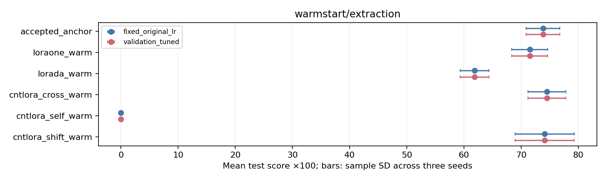

## warmstart/nfcorpus

Audit: `54077ac6a74d857abbb101b40add4fc75c5eaf555e1235ea1bc6bcad358fafeb`. Test examples: 323.

| Family | Fixed rate mean ± SD | Joint validation tuning mean ± SD |
|---|---:|---:|
| accepted_anchor | 32.02 ± 0.24 | 32.02 ± 0.24 |
| loraone_warm | 30.80 ± 0.15 | 32.15 ± 0.02 |
| lorada_warm | 31.09 ± 0.11 | 32.17 ± 0.13 |
| cntlora_cross_warm | 23.66 ± 0.27 | 26.70 ± 0.23 |
| cntlora_self_warm | 7.08 ± 0.11 | 16.97 ± 0.11 |
| cntlora_shift_warm | 13.99 ± 0.02 | 23.25 ± 0.66 |

| Joint-tuned family | Δ vs accepted [95% CI] | Δ vs scale-tuned Gaussian [95% CI] |
|---|---:|---:|
| accepted_anchor | +0.00 [+0.00, +0.00] | +0.19 [-0.40, +0.77] |
| loraone_warm | +0.13 [-0.75, +0.95] | +0.33 [-0.52, +1.14] |
| lorada_warm | +0.15 [-0.75, +1.00] | +0.34 [-0.54, +1.16] |
| cntlora_cross_warm | -5.32 [-7.06, -3.65] | -5.13 [-6.87, -3.45] |
| cntlora_self_warm | -15.05 [-17.52, -12.68] | -14.85 [-17.32, -12.49] |
| cntlora_shift_warm | -8.77 [-10.91, -6.75] | -8.57 [-10.59, -6.64] |

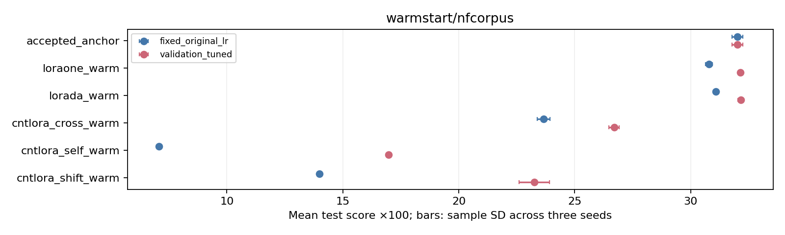

## warmstart/scifact_transfer

Audit: `54077ac6a74d857abbb101b40add4fc75c5eaf555e1235ea1bc6bcad358fafeb`. Test examples: 300.

| Family | Fixed rate mean ± SD | Joint validation tuning mean ± SD |
|---|---:|---:|
| accepted_anchor | 63.53 ± 0.24 | 63.53 ± 0.24 |
| loraone_warm | 63.03 ± 0.28 | 62.16 ± 0.58 |
| lorada_warm | 62.95 ± 0.28 | 61.68 ± 0.34 |
| cntlora_cross_warm | 47.11 ± 1.04 | 50.97 ± 0.26 |
| cntlora_self_warm | 12.76 ± 0.34 | 30.48 ± 0.81 |
| cntlora_shift_warm | 20.18 ± 0.82 | 38.03 ± 1.12 |

| Joint-tuned family | Δ vs accepted [95% CI] | Δ vs scale-tuned Gaussian [95% CI] |
|---|---:|---:|
| accepted_anchor | +0.00 [+0.00, +0.00] | +0.51 [-0.64, +1.70] |
| loraone_warm | -1.37 [-3.26, +0.51] | -0.86 [-3.04, +1.39] |
| lorada_warm | -1.84 [-3.74, +0.06] | -1.34 [-3.56, +0.88] |
| cntlora_cross_warm | -12.56 [-15.95, -9.19] | -12.05 [-15.51, -8.58] |
| cntlora_self_warm | -33.05 [-38.09, -28.09] | -32.54 [-37.50, -27.62] |
| cntlora_shift_warm | -25.50 [-30.12, -21.02] | -24.99 [-29.56, -20.48] |

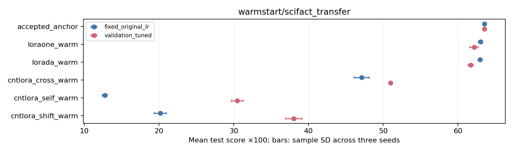

## warmstart/scifact

Audit: `82f613552c7ec2dabe992c4571359a1cc7dd6aa7fdb7e8820db7fa7a82352038`. Test examples: 300.

| Family | Fixed rate mean ± SD | Joint validation tuning mean ± SD |
|---|---:|---:|
| accepted_anchor | 67.99 ± 0.64 | 67.99 ± 0.64 |
| loraone_warm | 66.39 ± 0.26 | 66.39 ± 0.26 |
| lorada_warm | 65.59 ± 0.73 | 65.59 ± 0.73 |
| cntlora_cross_warm | 65.91 ± 0.10 | 65.91 ± 0.10 |
| cntlora_self_warm | 41.09 ± 0.40 | 41.09 ± 0.40 |
| cntlora_shift_warm | 65.47 ± 0.32 | 65.47 ± 0.32 |

| Joint-tuned family | Δ vs accepted [95% CI] | Δ vs scale-tuned Gaussian [95% CI] |
|---|---:|---:|
| accepted_anchor | +0.00 [+0.00, +0.00] | -1.03 [-2.27, +0.06] |
| loraone_warm | -1.60 [-3.30, +0.06] | -2.63 [-4.79, -0.57] |
| lorada_warm | -2.40 [-4.37, -0.48] | -3.43 [-5.58, -1.29] |
| cntlora_cross_warm | -2.07 [-4.51, +0.28] | -3.10 [-5.54, -0.61] |
| cntlora_self_warm | -26.89 [-31.42, -22.46] | -27.92 [-32.40, -23.46] |
| cntlora_shift_warm | -2.51 [-5.15, +0.14] | -3.54 [-6.15, -0.88] |

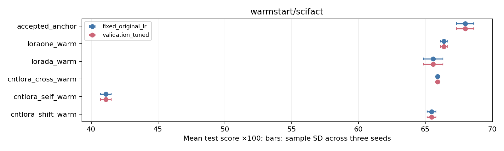

## Interpretation boundaries

Centered methods use W + (BA − B₀A₀). Warm starts retain the nonzero initial update. Full EVA rank redistribution, TLoRA rank/scale redistribution and frozen down factors, MiCA frozen up factors, and LoRA-SB/LoRA-Pro structural or optimizer changes are outside this initializer-only comparison. The frozen registry carries the exact solver, covariance, sign, precision, and source-default adaptations.

Training timers cover instrumented task training and its validation. `total_fit_wall_seconds`, when present, is the saved receipt interval: retrieval starts after injection, while Aircraft starts before injection. `initializer_seconds` separately records complete adapter injection for Aircraft/ViGGO when available. Missing timings remain null. Cached preprocessing and calibration costs are not inferred from training time. Identical fixed/joint fits share fit IDs and are not extra replicates.

Rebuild with `python -m experiments.init_report --rebuild report_inputs.json --output rebuilt`. All referenced source, prediction, audit, and checkpoint hashes must still match; model inference is unnecessary.
